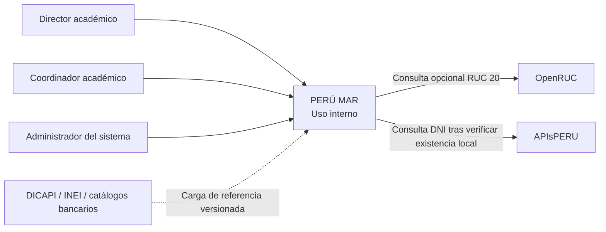
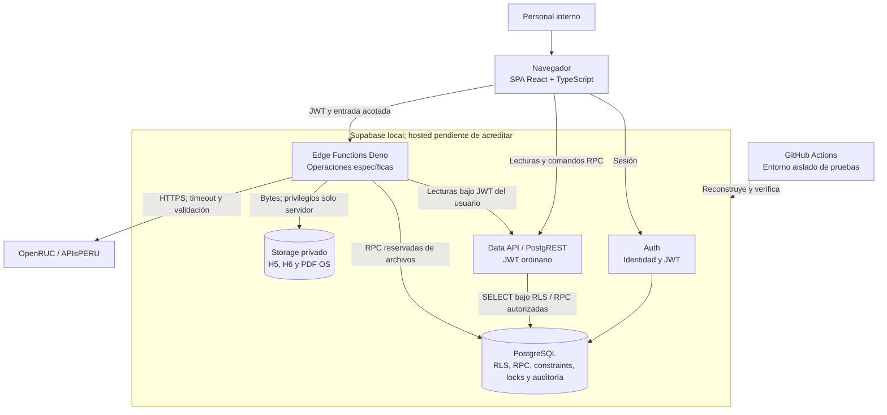
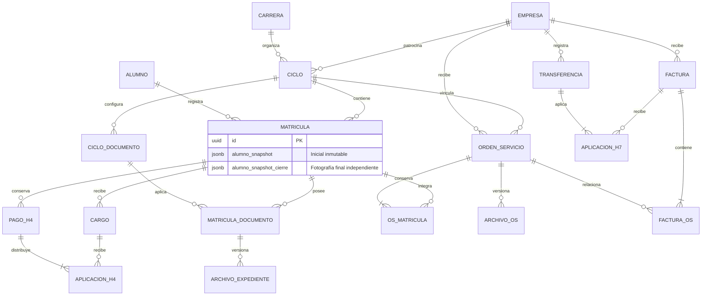
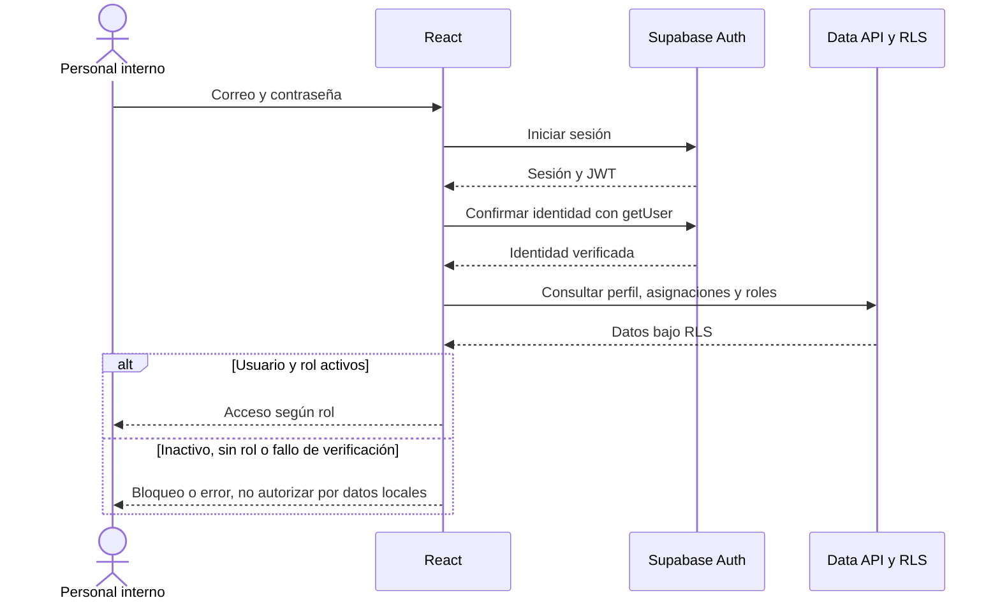
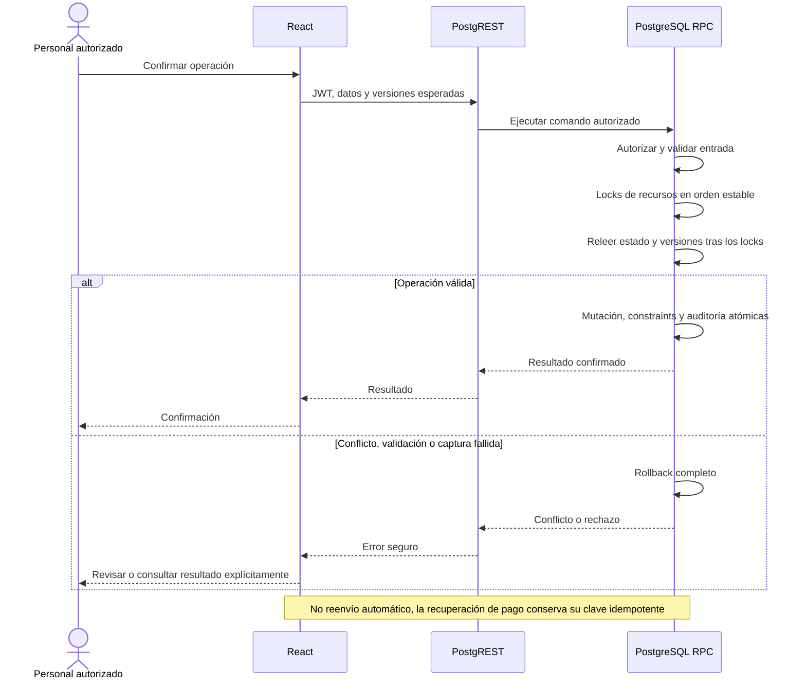
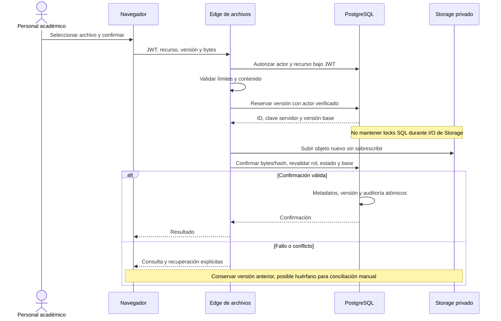
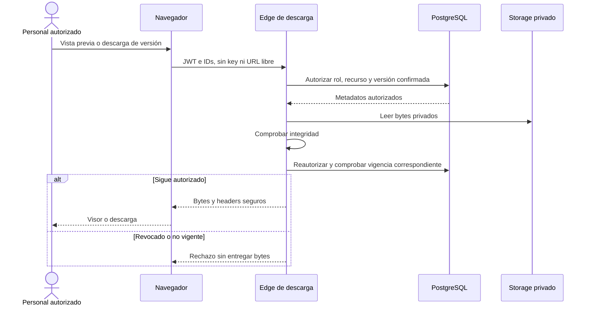
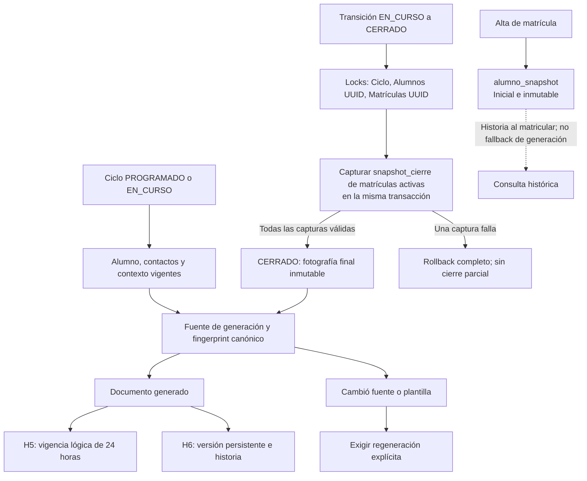

# Documento de Arquitectura — PERÚ MAR

Documento original: 23/11/2026 · Frankz Camasca. Revisión: **27/11/2026 (America/Lima)**.

**Estado hospedado vigente:** Supabase perumar-prod y Cloudflare Pages ejecutados; 42 migraciones (41 iniciales más la adición autorizada de asignaturas), ocho funciones ACTIVE v1 con JWT, claves nuevas y buckets privados. H7 está CLOSED / ACEPTADO / INTEGRADO en main `43bc1fc`. El [registro de cierre hospedado](../deployment/closure-2026-11-27.md) prevalece sobre las referencias temporales históricas de esta revisión. Integración de feature/hosted-deployment y cierre operativo aún pendientes; respaldo cifrado capturado, recuperación completa no acreditada. **No declarado apto para datos reales.** H8/H9 no iniciados; se mantienen las decisiones y diagramas existentes.

**Referencia técnica:** `44d60b12fa9f932b48e00e4d7720d0a1bb424b89`, rama `feature/h7-sponsors-billing-ui`. La versión original describía `fd230a7`; esta revisión incorpora H7 y la mejora DNI de H3. El cierre fue autorizado humanamente el 26/11/2026; [acceptance H7](../specs/H7-sponsors-billing/acceptance.md) registra candidato, validaciones y condiciones de integración. No se introducen decisiones arquitectónicas nuevas.

## 1. Propósito, alcance y audiencia

PERÚ MAR es una aplicación web de gestión académica que registra alumnos, matrículas, pagos y expedientes documentales, construida como una SPA en React sobre Supabase.

H6.2 y H7 están integrados; H7 permanece **CLOSED / ACEPTADO / INTEGRADO**. La mejora DNI corresponde a H3 y conserva sus commits independientes. Cada hito tiene su especificación en `docs/specs/`. El cierre hospedado posterior no reabre esos hitos.

| Hito | Capacidad que entrega |
| --- | --- |
| H0 | Arranque: configuración local verificada y build sin claves privadas |
| H1 | Seguridad: autenticación, roles y RLS |
| H2 | Modelo académico: materias, carreras y ciclos |
| H3 | Matrícula: alumnos, contactos de emergencia, empresas patrocinadoras y tarifas |
| H4 | Pagos: registro, anulación y saldos por cargo |
| H5 | Ficha de matrícula en PDF |
| H6 | Expediente documental: carga, generación y descarga de archivos |
| H6.1 | Reportes operativos por ciclo |
| H6.2 | Impresión del expediente y Word individual |
| H7, aceptado | Patrocinio por Ciclo, OS, facturas, transferencias, PDF OS privado y reportes/CSV |

**Fuera de alcance.** No hay acceso para alumnos: solo existen roles internos. No hay un despliegue hospedado acreditado, y el [PLAN vigente](../PLAN_MVP.md) registra la aceptación humana global de H7 y las confirmaciones de OpenRUC/domicilio fiscal/JSONB y DNI. Los pendientes de producción no se convierten en evidencia hospedada.

**Audiencia.** Quien deba mantener, auditar o desplegar el sistema. El documento describe el SHA técnico indicado arriba; los resultados históricos se mantienen vinculados a sus propias referencias. Los diagramas son Mermaid y se visualizan en GitHub o en un visor Markdown compatible.

## 2. Contexto y restricciones

El sistema atiende solo a personal interno, con tres roles, y está diseñado para operar primero en un entorno local controlado.

| Rol | Qué puede hacer |
| --- | --- |
| `DIRECTOR_ACADEMICO` | Ejecuta todas las operaciones académicas. Algunas son solo suyas: gestionar tarifas, cambiar el estado de un ciclo y anular pagos. |
| `COORDINADOR_ACADEMICO` | Lee todo el dominio académico y ejecuta las operaciones que no son exclusivas del Director, como anular matrículas y gestionar los documentos del expediente. |
| `ADMIN_SISTEMA` | Lee usuarios, roles y auditoría. No ve datos académicos ni de alumnos. |

Las restricciones que más condicionan el diseño son estas:

- **Configuración local primero.** El build acepta solo una URL y una clave publicable de Supabase locales, y rechaza configuración ausente, remota o privilegiada. No hay evidencia acreditada de respaldo remoto/restauración.
- **Sin registro público.** El alta abierta está desactivada y una prueba de CI verifica que se rechaza.
- **Datos personales.** La auditoría de alumnos, contactos de emergencia y empresas guarda solo el identificador y los nombres de los campos modificados, no sus valores. Los registros de las Edge Functions guardan solo códigos de categoría.
- **Sin despliegue hospedado.** `docs/specs/H6-expediente/operations.md` indica que no hay uno acreditado; los pendientes de producción están en la sección 11.

## 3. Vista de contexto

PERÚ MAR es de uso interno: tres roles acceden desde el navegador y las consultas opcionales OpenRUC y APIsPERU salen a proveedores externos exclusivamente mediante Edge. Los errores externos mantienen la alternativa manual; en DNI un error de comprobación local bloquea consulta externa y alta.

Los datos de DICAPI (cursos autorizados y mallas) y de INEI (ubigeo 2022) llegan como semilla de la base de datos y se versionan en `supabase/reference/`.

## 4. Vista de contenedores

El navegador utiliza Auth, Data API y Edge de Supabase. PostgreSQL concentra autorización/RLS, reglas y transacciones; Storage privado conserva bytes. Las consultas externas son específicas, no una API generalista de negocio.

Las Edge de archivos verifican JWT/rol/recurso antes de usar privilegios de servidor para Storage/RPC reservadas. Las consultas RUC/DNI usan el JWT ordinario y **no usan service_role**. El actor privilegiado se obtiene de Auth, no de un cuerpo libre. El esquema `private` no está expuesto por la Data API. Para peticiones de navegador se valida el Origin declarado contra una lista permitida. CORS no sustituye JWT/rol ni constituye una identidad de cliente.

## 5. Modelo de datos

En el SHA de referencia las migraciones declaran **35 tablas en public** (28 en fd230a7) y todo el negocio gira en torno a la matrícula; el esquema `private` guarda los correlativos de ciclo y de matrícula.

El diagrama muestra relaciones principales; omite seguridad, catálogos y algunas tablas auxiliares para facilitar su lectura. Los nombres abreviados corresponden a las tablas listadas debajo.

Las tarifas de un ciclo llegan a cada matrícula como cargos (`ciclo_tarifa` hacia `matricula_cargo`), y un pago se reparte entre cargos mediante `pago_aplicacion`. La matrícula guarda una instantánea de la ficha del alumno que cambios posteriores no reescriben.

| Dominio | Tablas |
| --- | --- |
| Seguridad | `app_users`, `app_roles`, `app_user_roles` |
| Referencia | `catalogo`, `catalogo_valor`, `departamento`, `provincia`, `distrito`, `capitania` |
| Académico | `materia`, `carrera`, `carrera_materia`, `ciclo`, `ciclo_materia` |
| Matrícula | `alumno`, `alumno_contacto_emergencia`, `empresa_patrocinadora`, `tarifa`, `ciclo_tarifa`, `matricula`, `matricula_cargo` |
| Pagos | `pago`, `pago_aplicacion` |
| Documentos | `tipo_documento`, `ciclo_documento`, `matricula_documento`, `matricula_documento_archivo` |
| Facturación H7 | orden_servicio, orden_servicio_matricula, factura_patrocinador, factura_orden_servicio, pago_patrocinador, pago_patrocinador_aplicacion |
| Archivos H7 | orden_servicio_archivo, técnica de versiones, no una nueva entidad comercial |
| Auditoría | auditoria; alumnos/contactos/empresas excluyen valores personales; eventos financieros conservan metadatos/importes permitidos |

## 6. Arquitectura de seguridad

La autorización se decide en el servidor: React no tiene autoridad de negocio y DB/RLS/RPC revalidan el acceso y las reglas correspondientes. React no puede aportar actor, permisos, estado arbitrario, SQL, object_key, bucket o URL libre como autoridad.

| Capa | Qué impone |
| --- | --- |
| Autenticación | JWT de Supabase Auth con expiración de 3600 s, sin registro público ni sesiones anónimas. |
| RLS | Las tablas de negocio de public tienen RLS; el inventario de esta revisión declara 35 tablas. La lectura exige un rol activo: Director y Coordinador leen el dominio académico, y Admin solo usuarios, roles y auditoría. |
| Sin escritura directa | Ninguna migración concede INSERT, UPDATE ni DELETE a `authenticated` ni a `anon`. Toda escritura entra por una RPC. |
| RPC | Las RPC de negocio tienen grants acotados y autorización servidor según operación. Las consultas/proyecciones respetan RLS; no se hereda el conteo histórico de 28 funciones para afirmar el inventario actual. |
| Privilegios de función | Las funciones privilegiadas restringen search_path según sus migraciones; cantidades, firmas y grants deben comprobarse contra el catálogo reconstruido, no heredar el conteo histórico de 36. Las funciones auxiliares viven en el esquema `private`, que la Data API no expone. |
| Edge Functions | Verifican origen, JWT, rol vigente y forma exacta de la entrada. Las de archivos usan privilegios de servidor solo para operaciones reservadas; consultar-ruc y consultar-dni no los necesitan. |
| Storage | Los buckets `fichas-matricula` (2 MB, PDF), `h6-expediente` (5 MB, PDF/JPEG/PNG) y `h7-os` (5 MiB, PDF) son privados y no tienen políticas para el cliente. |
| Cliente | El build rechaza claves `service_role` o `secret`. El único `dangerouslySetInnerHTML` renderiza un SVG de marca versionado en el repositorio. |

**Privilegios de archivos.** Las RPC técnicas solo admiten sus roles servidor autorizados. La Edge obtiene actor desde Auth; la DB revalida condiciones según cada comando. Un archivo histórico sigue requiriendo permisos actuales. El esquema private no es un endpoint cliente.

**Auth local.** El comentario de [config.toml](../../supabase/config.toml) explica que `[auth.email] enable_signup=true` mantiene habilitado el proveedor de correo para el acceso con contraseña; `[auth] enable_signup=false` bloquea el registro público. No es una contradicción que deba corregirse cambiando el valor a ciegas. Validar el comportamiento de la versión desplegada antes de producción.

**Límites de seguridad.** Esta revisión documental no es una auditoría nueva y no reafirma «sin hallazgos críticos ni altos» sin alcance, responsable y evidencia. Falta acreditar CSP/cabeceras del hosting, configuración productiva de contraseñas/MFA/límites, revisión de dependencias y restauración. La sesión persiste mediante supabase-js, pero no es autoridad de permisos. Auditoría y logs excluyen PII/secretos conforme a su contrato; la auditoría financiera sí conserva importes/estados autorizados.

## 7. Flujos clave

Los diagramas explican acceso, escritura, carga/descarga y procedencia histórica. Son esquemas de responsabilidades, no contratos exhaustivos de cada RPC.

### 7.1 Inicio de sesión

El navegador no confía en la sesión guardada: confirma la identidad con Auth y lee los roles bajo RLS. Si el usuario existe pero está inactivo o no tiene rol, queda bloqueado.

### 7.2 Escritura de negocio: matrícula y pago

Matrícula, edición, anulación y pago siguen este patrón: ninguna tabla se escribe directamente desde el cliente. Cada edición envía `expected_updated_at`, y si otra persona cambió el registro la base responde con un conflicto.

### 7.3 Carga de un archivo al expediente

La clave del objeto la genera el servidor y la subida no sobrescribe nada. El archivo solo se considera confirmado cuando la base registra su tamaño y su SHA-256.

### 7.4 Descarga de un archivo

La función vuelve a comprobar los permisos en la base después de leer de Storage y antes de devolver cualquier byte. La ficha de matrícula en PDF sigue un patrón parecido con la función `ficha-matricula` y el bucket `fichas-matricula`.

### 7.5 Procedencia del documento y cierre transaccional del Ciclo

`alumno_snapshot` conserva cómo se registró al alumno al matricular. `alumno_snapshot_cierre` solo cambia NULL→valor durante el cierre autorizado; En CERRADO los datos del Alumno/contactos proceden exclusivamente de esa fotografía, sin fallback al Alumno vigente ni al snapshot inicial; el contexto del documento se incorpora según su contrato. La captura admite etiquetas/geografía utilizadas aunque se hayan desactivado. Si falla una captura se revierten cierre, snapshots y auditoría; no queda cierre parcial. La auditoría excluye ambos snapshots para no copiar PII.

El protocolo académico consolidado es **Ciclo → Alumno(s) por UUID → Matrícula(s) por UUID**. H7 toma sus locks específicos de empresa/documentos según el comando; no se prescribe bloquear recursos ajenos en toda operación. `expected_updated_at` complementa los locks; errores SERIALIZABLE/deadlock no disparan retries automáticos.

El fingerprint incluye procedencia, datos/contexto que afectan al documento y versión de plantilla, excluyendo fecha de emisión. H5 exige regeneración ante cambio y conserva 24 h de vigencia lógica; no demuestra borrado físico automático. H6 conserva versiones privadas y puede ofrecer historia autorizada, distinta de la descarga ordinaria vigente. [Fuente técnica de snapshots y cierre](../../supabase/migrations/20261113010000_h5_current_and_closure_source.sql).

## 8. Arquitectura del frontend

El frontend es una SPA de React 19 que lee con `supabase-js` bajo RLS, escribe solo mediante RPC y trata los permisos de la interfaz como ayuda de uso, no como control de acceso.

| Carpeta | Responsabilidad |
| --- | --- |
| `src/security` | Sesión, rutas protegidas, inicio de sesión y menú de cuenta |
| `src/academic` | Materias, carreras, ciclos y consulta de auditoría |
| `src/enrollment` | Alumnos, matrículas, tarifas, empresas patrocinadoras y ficha PDF |
| `src/payments` | Registro y anulación de pagos, saldos por cargo |
| `src/documents` | Expediente: carga, vista previa, impresión y Word individual |
| `src/reports` | Reportes operativos por ciclo |
| `src/billing` | Facturación H7, archivos privados de OS y reportes/CSV |
| `src/lib` | Cliente de Supabase, validación de entorno, textos de formulario, búsqueda de alumnos y mapeo de errores |

- **Sesión.** `SessionProvider` no confía en el almacenamiento local: confirma la identidad con el servidor y lee `app_users` y `app_user_roles` bajo RLS. El resultado es una de cinco fases: cargando, anónimo, autorizado, bloqueado o error. El cliente HTTP general impone cinco segundos; las Edge de archivos tienen presupuestos específicos, por ejemplo 15 segundos en expediente/OS. No confundir límite por petición con tiempo de toda una operación.
- **Permisos de interfaz.** Componentes como `AcademicOnly` ocultan pantallas según el rol. La autoridad real sigue en RLS y en las RPC.
- **Concurrencia optimista.** Cada edición envía `expected_updated_at`. Si otra persona cambió el registro, la base responde con un conflicto (`PT409`, `40001` o `40P01`) y la interfaz pide actualizar antes de guardar.
- **Errores.** `enrollmentError` y `paymentError` traducen códigos y mensajes de la base de datos a textos para el usuario.
- **Documentos en el navegador.** La vista previa de PDF, el PDF de reportes por ciclo, la unión de PDFs para imprimir expedientes y el Word individual se generan en el cliente y se cargan bajo demanda con `import()`. El Word usa un escritor propio de paquetes OOXML sin compresión, sin relaciones externas ni macros.
- **Imágenes.** Antes de subir una foto, el usuario puede pedir una copia optimizada de hasta 2000 px por lado y menos de 5 MiB. El original no se modifica.

El bundle supera 500 kB, un residual que `docs/architecture/GATE-A01-continuidad-supabase.md` acepta de forma explícita.

### Presentación de facturación H7 y proyecciones

H4 es autoridad para cargos/pagos académicos; H6 para completitud documental; H7 para saldo comercial de factura. No hay deuda combinada H4+H7 ni prorrateo de factura por alumno/Ciclo. Las aplicaciones de transferencia sí asignan importes a facturas conforme a su contrato. Las vistas de saldo, resumen, cobertura y `facturacion_reporte` son lecturas bajo RLS/security_invoker, no estados financieros persistidos.

El patrocinio actual deriva de la empresa del Ciclo. Su cambio no reescribe OS, facturas, aplicaciones ni pagos anteriores. La pertenencia histórica se conserva en OS↔matrícula; reportes usan identificación del snapshot inicial, no el Alumno actual. Código de matrícula/Ciclo son referencias de esos registros, no nuevos snapshots capturados al emitir OS.

- La matrícula solo indica que la facturación la asume el patrocinador; el detalle comercial permanece en Empresa→Facturación.
- Factura muestra un **Estado unificado derivado**: Anulada prevalece; luego Pagada/Pago parcial según pagos confirmados; sin abonos muestra la etapa del trámite. El workflow y estado financiero siguen separados internamente; pagar no reescribe el seguimiento manual.
- Los tres listados existentes permiten filtros servidor, paginación estable por fecha/UUID y CSV completo filtrado. Fórmulas tras espacios/controles se neutralizan; Unicode, comillas y saltos se conservan. Una fila por documento evita multiplicar importes por joins. Totales monetarios excluyen anulados; personas/matrículas se deduplican según el rótulo del exportador.
- CSV usa lotes, comprueba count/IDs y reevalúa acceso antes de entregar; no es un snapshot transaccional y no detecta todo cambio concurrente con igual cardinalidad. Memoria proporcional al volumen de filas/relaciones. No se añade PDF de reportes H7.
- OS/factura conservan los dígitos ingresados sin completar/quitar ceros. Serie mantiene las normalizaciones existentes de espacios/mayúsculas; no se inventa prefijo fiscal. Los registros previos no se reformatean.
- Las transferencias usan clave idempotente. Respuesta incierta requiere consulta/reconfirmación humana del mismo intento/clave, también tras remount; sin nueva clave ni reenvío automáticos.
- Anular OS exige regularizar facturas no anuladas asociadas; anular factura exige regularizar aplicaciones vigentes de pagos confirmados. Solo el rol autorizado, motivo obligatorio, historia conservada; sin cascadas ni DELETE físico.

## 9. Decisiones de arquitectura

El proyecto eligió React con Supabase frente a otras dos alternativas, y el gate GATE-A01 aprobó continuar con ajustes el 18-nov-2026. La tabla reúne las decisiones que sostienen el diseño; la numeración ADR es propia de este documento.

| ADR | Decisión | Por qué | Fuente |
| --- | --- | --- | --- |
| ADR-01 | Plataforma: React, Supabase Auth, PostgreSQL con RLS, RPC, Edge Functions acotadas y Storage privado | Menos código repetitivo y menos operación que una API propia o AWS serverless, para una institución con pocos usuarios concurrentes | `Informe_Alternativas_Arquitectura_PERUMAR.md`, sección 13 |
| ADR-02 | Las escrituras de negocio entran solo por RPC transaccionales, sin DML directo desde el cliente | Matrícula, costos y pagos necesitan atomicidad, concurrencia explícita y auditoría confirmada junto con el cambio | Informe de alternativas, sección 13; GATE-A01 |
| ADR-03 | Edge acotadas de archivos/documentos y excepciones posteriores autorizadas consultar-ruc/consultar-dni | No trasladar todas las reglas a una API generalista; consultas externas sin service_role | GATE-A01; enmienda OpenRUC H7 y mejora DNI H3 |
| ADR-04 | Storage privado de Supabase; sin S3 ni capa genérica de proveedor. La identidad de un documento es su clave de objeto y sus metadatos, nunca una URL | Menor complejidad e integración con Auth, RLS y Edge | GATE-A01, sección Storage para H6 |
| ADR-05 | Archivos en tres pasos: reserva técnica, carga y confirmación. La clave de objeto la genera el servidor y no se permite sobrescribir | No mantiene un bloqueo en la base de datos durante la subida y permite revalidar el vínculo en la base de datos | `docs/specs/H6-expediente/design.md` |
| ADR-06 | PDFs institucionales generados con `pdf-lib` en Edge Functions | H5 acreditó la viabilidad; cada documento futuro se evalúa por separado | GATE-A01, criterio Documentos |
| ADR-07 | Sin infraestructura adicional por defecto: ni API Node, Lambda, S3, colas, microservicios, Kubernetes ni motor documental externo | Una necesidad futura exige evaluación y autorización explícitas | GATE-A01 |
| ADR-08 | Configuración pública local: el build rechaza claves privadas y configuración remota | Evita que una clave privilegiada llegue al bundle del navegador | `docs/specs/H0-bootstrap/design.md` |

**Segunda opción.** Una API ligera con PostgreSQL administrado pasaría al primer lugar si mantener SQL y RLS resulta menos claro que un backend convencional, o si el motor documental exige un runtime más flexible.

## 10. Calidad y pruebas

La CI definida reconstruye Supabase local y usa identidades reales. Algunos checkpoints omitieron CI por instrucciones específicas; un resultado local no acredita CI ni hosted. Verificar la ejecución del SHA concreto y sus disparadores. La CI histórica H6.1 cerró 590/590; ese resultado no se atribuye a H7.

| Nivel | Qué verifica | Dónde |
| --- | --- | --- |
| Unitarias y de interfaz | Componentes React, utilidades, generación de PDF y Word, y contratos de las Edge Functions | 50 archivos Vitest en el SHA de referencia; ejecuciones y cantidades por candidato en technical-results |
| SQL | Invariantes, concurrencia, rollback y casos adversariales sobre la base | tests/sql y scripts aislados específicos; consultar inventario del SHA |
| Integración con identidades reales | Matriz de actores con Auth y RLS reales, sin `service_role` para probar autorización; matrícula, pagos con concurrencia real, PDF y expediente con Edge y Storage reales | scripts/test-*.mjs; incluye núcleo financiero H7 y reportes con JWT ordinarios |
| Diseño de impresión | Maquetación de la ficha, el expediente y los reportes en PDF | `test-pdf-layout.mjs`, `test-expediente-layout.mjs` y `test-cycle-report-pdf-layout.mjs` |
| Aceptación humana | Bloques de revisión por hito antes de cerrarlo | `acceptance.md` y `gate-2.md` de cada especificación |

El pipeline de `.github/workflows/ci.yml` corre en este orden:

1. Instala con npm 10.9.0 fijo y `npm ci`.
2. Ejecuta lint, comprobación de tipos de la aplicación y de las Edge Functions, y las pruebas unitarias.
3. Levanta Supabase local aislado y lo reinicia con todas las migraciones.
4. Corre seguridad, académico, matrícula, pagos, núcleo H7 y reportes/CSV DB/API/JWT; repite los bloques configurados tras reconstrucción.
5. Corre las pruebas de PDF y de expediente contra Edge y Storage reales.
6. Construye el frontend y comprueba que una configuración privilegiada se rechaza.
7. Verifica la expiración real del token y la restauración del perfil.
8. Reconstruye la base y repite las pruebas de integración.

Las acciones de GitHub están fijadas por SHA y el workflow tiene permisos de solo lectura. La evidencia sintética de las pruebas se conserva 3 días como artefacto.

## 11. Despliegue y operación

Hoy el sistema corre solo en local, con Docker y la CLI de Supabase; `docs/specs/H6-expediente/operations.md` indica que no hay un despliegue hospedado acreditado.

| Elemento | Valor |
| --- | --- |
| Entorno de ejecución | Node 24.19.0, npm 10.9.0 y Docker con motor Linux |
| CLI y SDK | Supabase CLI 2.121.0 y `supabase-js` 2.118.0, ambos fijados |
| Puertos locales | Aplicación 5173, API 54321, base de datos 54322, Studio 54323 y correo 54324 |
| Variables del frontend | `VITE_SUPABASE_URL` y `VITE_SUPABASE_PUBLISHABLE_KEY`, generadas con `npm run supabase:env` |
| Variables de las Edge Functions | `EXPEDIENTE_ALLOWED_ORIGINS`, `FICHA_ALLOWED_ORIGINS`, `H7_OS_ALLOWED_ORIGINS`, `RUC_ALLOWED_ORIGINS` y `DNI_ALLOWED_ORIGINS`, según handler. El valor local por defecto es `http://127.0.0.1:5173`; fuera de local, sin valor se rechaza todo origen de navegador |
| Migraciones | 41 migraciones SQL en el SHA de referencia, frente a 29 en fd230a7, ordenados por fecha. No se edita una migración ya aplicada; una base con datos se actualiza con `migration up --local`, no con `reset` |
| Datos de referencia | `seed.sql` y `supabase/reference/`: catálogos, ubigeo INEI 2022 y cursos autorizados de DICAPI |

**Operación manual.** Los archivos del expediente nunca confirmados se concilian con `npm run expediente:cleanup`, que primero cuenta y solo borra con `--execute`. La limpieza de los PDFs temporales de la ficha usa `npm run pdf:cleanup`. No hay planificador ni purga física automática de confirmados. La ficha H5 sí tiene vencimiento lógico; no equivale a borrar su objeto. Las OS también pueden dejar huérfanos sujetos a conciliación manual.

**Pendiente antes de producción.**

- [ ] Crear el proyecto Supabase alojado y el hosting, y probar Edge Functions y PostgREST en ese entorno
- [ ] Medir CPU y memoria de las Edge Functions con archivos de tamaño real
- [ ] Definir todos los orígenes HTTPS permitidos de archivos y proveedores; CORS no sustituye JWT/rol
- [ ] Revisar y autorizar el contrato de build para producción: hoy rechaza URL remota; no basta cambiar las variables
- [ ] Configurar secretos solo servidor y confirmar cuenta/plan/uso autorizado antes de habilitar APIsPERU en producción
- [ ] Configurar Auth alojado: política de contraseñas, MFA y límites de intentos
- [ ] Añadir Content-Security-Policy y cabeceras de seguridad en el hosting
- [ ] Probar la restauración de base de datos y archivos juntos; la reconstrucción local no es un respaldo
- [ ] Decidir la política de purga definitiva, diferida a H9 o al release

### Consultas externas y secretos de servidor

Las excepciones autorizadas a Edge son acotadas; no cambian la autoridad de DB ni crean una API de negocio genérica.

| Integración | Contrato y alternativa |
| --- | --- |
| OpenRUC H7 | RUC 11/verificador/prefijo20, JWT/rol antes y después del I/O, timeout 5 s, respuesta/source/as_of validados, sin `_more`, redirects ni service_role. No se presenta como API oficial SUNAT ni verificación fiscal en tiempo real. Otros RUC/error permiten registro manual. |
| Persistencia de empresa | Razón social y domicilio fiscal operativos editables; última referencia tributaria JSONB normalizada separada de correcciones. Consulta no guarda: la RPC existente persiste solo al confirmar Guardar empresa. |
| APIsPERU H3 | DNI 8 dígitos, Auth/rol, comprobar primero existencia local incluyendo inactivos. Existente: sin consulta externa ni alta. Error local: sin proveedor ni alta. Solo fallo externo permite continuar manualmente tras nueva verificación al guardar; la unicidad DB cubre carreras. Timeout5s y autocompletado editable. |

APISPERU_TOKEN existe solo en Edge. El archivo privado local `supabase/functions/.env.local` está ignorado por Git; la [plantilla](../../supabase/functions/.env.example) no contiene su valor. Iniciar `functions serve` con `--env-file supabase/functions/.env.local`: un token en el archivo frontend de la raíz no garantiza que llegue al worker. Nunca VITE_, logs, capturas ni URL devuelta al usuario; no registrar la URL completa del proveedor, que recibe el token conforme a su contrato HTTPS.

Producción permanece bloqueada mediante APISPERU_PRODUCTION_AUTHORIZED hasta confirmar cuenta/plan, cuota/condiciones y uso autorizado. No se afirma autorización de RENIEC por utilizar un proveedor. RUC/DNI salen exclusivamente al proveedor necesario; los handlers no registran nombres, DNI, RUC, token ni errores crudos. No hay caché, tabla o contador nuevo de consultas. Eldni queda como investigación concluida no seleccionada.

[OpenRUC](../specs/H7-sponsors-billing/openruc.md), [mejora DNI](../specs/H3-enrollment/implementation-log.md), [handler RUC](../../supabase/functions/_shared/ruc/http.ts) y [handler DNI](../../supabase/functions/_shared/dni/http.ts).

## 12. Riesgos, deuda técnica y evolución

El MVP continúa con residuales aceptados que siguen sin resolverse; los más relevantes para producción deben cerrarse o aceptarse de nuevo antes de H9.

| Tema | Estado | Fuente |
| --- | --- | --- |
| Edge Functions y PostgREST alojados | No probados directamente | GATE-A01 |
| CPU y memoria de las Edge Functions | No medidas | GATE-A01 |
| Contraste forzado (forced-colors) en H5 y H6 | No verificado | `docs/PLAN_MVP.md` |
| Tamaño del bundle | Supera 500 kB | GATE-A01 |
| Limpieza física de archivos | Manual: PDFs de H5 y reservas nunca confirmadas de H6. La purga definitiva queda diferida a H9 | `operations.md` de H6 |
| Compatibilidad de PDF | Conservadora: admite compresión estructural acotada y URI HTTP/HTTPS/mailto seguras; mantiene rechazo de cifrado, formularios, contenido activo y estructuras no verificables. No equivale a antivirus/CDR | `operations.md` de H6 |
| Reportes CSV y PDF | Sin instantánea transaccional; la memoria de exportación crece con el volumen | `docs/PLAN_MVP.md`, H6.1 |
| Seguridad | CSP hospedada implementada; Auth revisado previamente en Dashboard, recaptura bloqueada por auth_config_read. Revisión actual de dependencias pendiente; no se afirma mantenimiento del proveedor sin verificación específica | Sección 6 y cierre hospedado |
| Proveedores externos | OpenRUC/RUC20 y condiciones/cuota del proveedor DNI; alternativa manual y autorización de producción por confirmar | H7 OpenRUC / H3 DNI |

**Próximos hitos y evoluciones.**

- **H7, Patrocinadores y facturación.** Gate2 humano aprobado; CLOSED / ACEPTADO. PR/merge commit y CI exacta de main obligatorios para declarar INTEGRADO; referencias finales en el informe y PR de integración. H8 no iniciado.
- **H8, Reportes y operación.** Estados de cuenta, filtros, exportación y consulta de auditoría, sin una plataforma analítica aparte.
- **H9, Cierre del MVP.** Revisión de permisos, respaldos y restauración, configuración productiva, revisión de secretos y preparación del release.
- **EVOL-001.** Que el Coordinador solicite un descuento y el Director lo apruebe. Pendiente.
- **EVOL-002.** Importación de alumnos y matrículas desde Excel. Pendiente.

## 13. Glosario

| Término | Significado |
| --- | --- |
| DICAPI | Dirección General de Capitanías y Guardacostas. El sistema registra el código de curso y la resolución de malla que ella autoriza |
| Carrera | Programa formativo que agrupa materias; la interfaz lo llama «Curso» en las tarifas y los cargos |
| Materia | Asignatura que forma parte de una o más carreras |
| Ciclo | Edición de una carrera. Pasa por los estados programado, en curso, cerrado, desierto o anulado |
| Matrícula | Inscripción con snapshot inicial inmutable y fotografía final de cierre independiente |
| Cargo | Importe que debe pagar una matrícula. Los pagos se aplican a cargos y el saldo se calcula a partir de ellos |
| Ficha de matrícula | PDF con los datos de la matrícula, generado en una Edge Function |
| Expediente | Documentos de una matrícula, subidos o generados: solicitud, declaración jurada, carta poder, ficha de datos personales y ficha de matrícula |
| Hito (H0 a H9) | Etapa del plan del MVP, con su especificación en `docs/specs/` |
| Gate | Revisión humana que autoriza avanzar. El Gate 1 aprueba la especificación antes de construir y el Gate 2 acepta el resultado |
| RLS | Row Level Security: reglas de PostgreSQL que deciden qué filas puede ver cada usuario |
| RPC | Función de la base de datos que el cliente invoca por la API; aquí concentra todas las escrituras |
| Edge Function | Función de servidor en Deno que Supabase ejecuta cerca del usuario; aquí procesa archivos/documentos y consultas externas específicamente autorizadas |

## 14. Trazabilidad y mantenimiento de esta revisión

- [PLAN](../PLAN_MVP.md), [Gate A01](GATE-A01-continuidad-supabase.md), [Gate 1 H7](../specs/H7-sponsors-billing/gate-1.md) y Specs históricas gobiernan autorización/alcance. Los ADR de este documento son etiquetas descriptivas, no decisiones humanas nuevas.
- [Fuentes/cierre](../../supabase/migrations/20261113010000_h5_current_and_closure_source.sql), [reportes H7](../../supabase/migrations/20261125060000_h7_read_reports.sql), [numeración sin relleno](../../supabase/migrations/20261125070000_h7_document_number_as_entered.sql), [validador PDF](../../supabase/functions/_shared/expediente/validateFile.ts).
- [Evidencia H7](../specs/H7-sponsors-billing/technical-results.md): 839/839 Vitest en 50 archivos en el cierre; 192/192 núcleo financiero con reconstrucción/concurrencia/JWT; 41/41 reportes y 52/52 datos tributarios aislados, además de baterías de patrocinio, cobertura OS, disponibilidad de OS y PDF OS. Lint/tipos/Edge/build correctos. La CI completa y las referencias exactas gobiernan la integración; no se hereda SUCCESS de otro SHA.
- El workflow se dispara en ramas feature, PR a main y push a main, además de ejecución manual. Main exige regresión integral sobre su SHA exacto; no heredar CI de otro SHA. Revisar el resultado exacto de cada candidato.
- Los estados iniciales de documentos históricos de operación se leen junto con sus registros posteriores de aceptación y el PLAN vigente. No se reescriben Gates/Specs históricos para simular una aprobación nueva.

**Actualización de cierre autorizada el 26/11/2026.** Mantiene los ocho diagramas Mermaid y las decisiones arquitectónicas existentes. Vincula el cierre H7 y la mejora H3 a su evidencia; no incorpora secretos, despliega producción ni inicia H8. Los límites de validación y residuales se conservan.

Validaciones documentales de esta revisión: **8/8 bloques Mermaid aceptados por el parser mermaid@11.4.1**, 16 enlaces locales existentes, inventarios contrastados y diff documental sin errores. Es validación sintáctica, no una revisión visual de renderizado ni una nueva batería funcional/CI. El parser se usó solo en .cache ignorado, sin modificar package.json/package-lock ni dependencias del producto.
