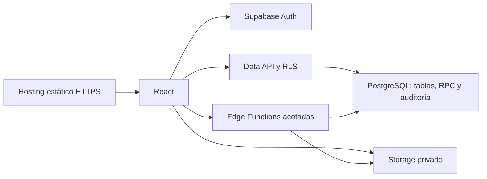
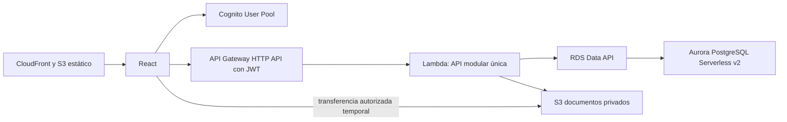
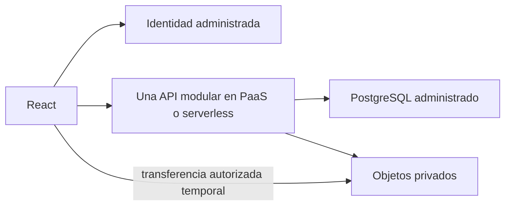

# Evaluación de nuevas alternativas arquitectónicas para PERÚ MAR

**Fecha:** 21 de octubre de 2026. **Naturaleza:** evaluación y diseño conceptual; sin implementación, DDL ni plan de migración.

**Recomendación:** para el contexto actual, elegiría **React + Supabase**, con CRUD protegido mediante SQL/RLS, operaciones críticas mediante RPC transaccionales y funciones de servidor acotadas para documentos, archivos y administración de identidad. La segunda opción sería **una API ligera + PostgreSQL administrado**, especialmente si el mantenedor prefiere concentrar las reglas en código convencional o si los documentos requieren un motor de renderizado que no encaje en las funciones Edge. AWS Serverless relacional es viable, pero no ofrece una ventaja proporcional al trabajo de integración para las necesidades conocidas.

Es una conclusión de diseño, no un benchmark. Supabase reduce código de API, no elimina backend ni pruebas. Las tres alternativas representan bien el dominio porque las tres utilizan PostgreSQL. La ventaja de una sobre otra está en dónde vive la lógica, cuánta infraestructura debe coordinarse y qué debe aprender y mantener una persona.

## Base, supuestos y límites de la comparación

La fuente principal es [Informe_Evaluacion_Arquitectonica_PERUMAR.md](D:/FRANKZ/aplicaciones/PERUMAR/Informe_Evaluacion_Arquitectonica_PERUMAR.md), especialmente requisitos RA01–RA15, reglas del dominio y vacíos. El informe está en la raíz del proyecto, no dentro de DocumentosPM. Se utilizan como soporte funcional las HU1–18, HU20 y HU23 de [Historias_de_Usuario.md](<D:/FRANKZ/aplicaciones/PERUMAR/DocumentosPM/Análisis/versiones anteriores/Historias_de_Usuario.md>), la priorización [MVP - priorización y secuencia.docx](<D:/FRANKZ/aplicaciones/PERUMAR/DocumentosPM/Análisis/MVP - priorización y secuencia.docx>) y los formatos del expediente ya examinados en el diagnóstico.

No se vuelven a evaluar implementaciones históricas ni se inspecciona su código. Se compara una solución nueva para una institución, baja concurrencia y crecimiento moderado. No se incluyen tenants, aprovisionamiento institucional, facturación SaaS, particiones por cliente ni microservicios.

Para comparar capacidades equivalentes se cubren también patrocinadores y pagos de varias facturas, aunque su inclusión exacta en el primer release siga pendiente. El motor avanzado de plantillas no se declara obligatorio para la primera entrega: se distingue una ficha fija de la edición enriquecida del alcance amplio.

Las propuestas de transacciones, bloqueos, idempotencia y estados de archivos son **decisiones de diseño sugeridas**, derivadas de los requisitos de consistencia y auditoría; no se presentan como reglas de negocio adicionales ya aprobadas. La experiencia del mantenedor en SQL/RLS, AWS y backend convencional no está documentada. Se asume competencia general en desarrollo web y disposición a trabajar con SQL; este supuesto afecta la recomendación.

Las capacidades variables se verificaron en fuentes oficiales de Supabase, AWS, PostgreSQL y OWASP durante esta evaluación. Las citas se incluyen junto a los hechos relevantes. No se estiman dólares, SLA ni RPO/RTO inventados. Tampoco se afirman pruebas ejecutadas: los casos de la sección 3 son escenarios de diseño y verificación futura.

# 1. Arquitectura mínima de cada alternativa

## A. React + Supabase

El diagrama muestra accesos lógicos. React no abre una conexión SQL: llama a la Data API o a RPC bajo identidad del usuario. Auth no se encadena obligatoriamente en cada lectura; emite la sesión que las peticiones presentan después.

| Responsabilidad | Mínimo propuesto |
|---|---|
| Frontend | Una SPA React y un hosting estático HTTPS. El hosting debe presupuestarse y configurarse; no se asume incluido por tener Supabase |
| Backend | Data API administrada para operaciones simples; RPC de PostgreSQL para matrículas/pagos; un conjunto pequeño de Edge Functions para tareas privilegiadas e integración de archivos/PDF |
| Persistencia | Una base PostgreSQL, esquema versionado y restricciones de integridad |
| Autenticación | Supabase Auth, acceso institucional mediante invitación/alta autorizada; correo de recuperación con SMTP de producción |
| Autorización | Roles y estado de usuario en tablas de aplicación; grants mínimos, RLS y validación de permisos en RPC privilegiadas |
| Archivos | Bucket privado; carga autorizada, ruta generada y metadatos de expediente; descarga autenticada o temporal |
| Documentos | Ficha fija con biblioteca PDF en función de servidor, previa comprobación de fuentes/layout y límites de ejecución. No se incorpora un navegador remoto por defecto |
| Auditoría | Tabla de negocio protegida, triggers para mutaciones simples y eventos explícitos dentro de las RPC críticas |
| Secretos | Secretos de funciones/plataforma y del pipeline; ninguna clave privilegiada en React |
| Observabilidad | Logs de API/Auth/Storage/PostgreSQL/funciones en la plataforma; ID de operación para correlacionar con auditoría |
| Backups | Backup PostgreSQL del plan elegido y copia recuperable separada de archivos; procedimiento de restauración probado |
| Deployment | Un repositorio con frontend, migraciones/políticas/RPC y funciones; pipeline secuencial de validación y despliegue |

Las políticas RLS y los permisos SQL deben diseñarse juntos; una sesión autenticada no concede permiso funcional automáticamente. Views, funciones y claves privilegiadas requieren revisión especial. [Supabase: RLS](https://supabase.com/docs/guides/database/postgres/row-level-security).

**Acceso directo seguro desde React:** lectura autorizada de catálogos y listados; CRUD de una materia; alumnos y contactos si cada operación conserva las restricciones; consultas de reportes mediante vistas seguras. Carrera con varias materias puede usar lectura directa, pero su escritura conjunta debe tener una RPC para no dejar media actualización.

**Servidor necesario:** matricular, aplicar pagos, distribuir un abono entre facturas, administrar usuarios/roles, confirmar adjuntos tras validación de contenido y emitir documentos auditados. Algunas de estas tareas viven en PostgreSQL; no todas necesitan Edge Functions. Por diseño se revoca la escritura directa en tablas financieras y otras tablas controladas exclusivamente por comandos.

**Backend propio acotado:** SQL, RLS y RPC son código propio de servidor. Eliminar controladores CRUD no autoriza a repartir el cálculo de saldos entre navegador y varios servicios.

**Límites que sí importan:** las Edge Functions alojadas documentan 256 MB de memoria y 2 segundos de CPU por solicitud; el tiempo de pared es diferente. Por ello no se promete renderizar cualquier HTML ni un ZIP completo por ciclo en una única invocación. [Supabase: límites de funciones](https://supabase.com/docs/guides/functions/limits).

El correo SMTP de prueba no es una solución productiva para invitaciones y recuperación. Se contempla un servicio de correo configurado, aprovechando uno existente si lo hay. [Supabase: SMTP](https://supabase.com/docs/guides/auth/auth-smtp).

## B. AWS Serverless relacional

No es una cadena «React → Cognito → API» para cada petición. El usuario obtiene tokens de Cognito; la SPA sirve desde CloudFront y presenta el access token al endpoint de API Gateway.

| Responsabilidad | Mínimo propuesto |
|---|---|
| Frontend | Una SPA React en S3 privado, distribuida por CloudFront con acceso al origen restringido |
| Backend | Una HTTP API y una Lambda que contenga módulos de aplicación; no una Lambda por endpoint o entidad |
| Persistencia | Un clúster Aurora PostgreSQL Serverless v2 con un writer; sin readers adicionales por anticipación |
| Acceso a datos | Data API si región/versión y consultas son compatibles. Evita administrar conexiones persistentes desde Lambda |
| Autenticación | Cognito User Pool, cliente público para SPA y flujo Authorization Code con PKCE; no Identity Pool si el usuario solo consume la API y URLs temporales |
| Autorización | JWT authorizer en HTTP API; permisos de negocio y usuario activo comprobados en Lambda usando PostgreSQL |
| Archivos | S3 privado separado del frontend; backend autoriza y genera carga/descarga temporal |
| Documentos | Biblioteca PDF en la misma aplicación. Separar ejecución PDF solo si los límites observados lo requieren |
| Auditoría | Tabla PostgreSQL y escritura en la misma transacción que la operación crítica |
| Secretos | Rol IAM de ejecución, permisos mínimos y Secrets Manager para credenciales de Data API; sin access keys estáticas en aplicación |
| Observabilidad | CloudWatch para access logs, logs estructurados, errores y alarmas básicas; no plataforma paralela |
| Backups | Backups/restauración de Aurora y protección recuperable de objetos S3; configuración de retención explícita |
| Deployment | Un repositorio y definición declarativa pequeña de infraestructura, frontend, Lambda y migraciones |

Data API ofrece SQL por HTTPS y permite que Lambda acceda al clúster sin adjuntar la función a la VPC. El clúster sigue necesitando su configuración de red; la alternativa no elimina VPC/subnets de Aurora. Data API usa credenciales en Secrets Manager. [AWS: Data API](https://docs.aws.amazon.com/AmazonRDS/latest/AuroraUserGuide/data-api.html).

Para operaciones múltiples se debe usar la misma transacción Data API mediante su identificador, ejecutar sentencias en secuencia y confirmar o revertir. No se sustituye una transacción por varias invocaciones de Lambda. Sus límites de respuesta y expiración exigen paginar reportes y mantener las transacciones cortas. [AWS: operaciones Data API](https://docs.aws.amazon.com/AmazonRDS/latest/AuroraUserGuide/data-api.calling.html), [AWS: límites y errores Data API](https://docs.aws.amazon.com/AmazonRDS/latest/AuroraUserGuide/data-api.troubleshooting.html).

### ¿Todos los componentes son necesarios?

| Componente | Decisión para esta alternativa |
|---|---|
| S3 + CloudFront estáticos | Se conservan como hosting HTTPS de la SPA dentro de AWS; no se añade otra CDN delante |
| Cognito | Se conserva un proveedor de identidad administrado; otro IdP podría reemplazarlo si ya existiese, pero no se duplican |
| API Gateway | No es obligatorio para toda Lambda, pero se conserva HTTP API por JWT authorizer, rutas y controles HTTP. Una Function URL reduciría un servicio y trasladaría validación JWT y controles a la aplicación; no supone menor trabajo automáticamente |
| Lambda | Una aplicación modular es suficiente para CRUD y comandos; evita proliferación inicial |
| Aurora Serverless v2 | Parte de la opción solicitada; no se confunde «serverless» con costo cero en reposo |
| RDS Proxy | No se incluye con Data API. Agregarlo no mejora este camino y sus conexiones interfieren con la pausa automática |
| NAT Gateway | No se incluye en el camino Lambda fuera de VPC + Data API; con conexión SQL directa habría que resolver salida y red de manera explícita |
| WAF, tracing externo, colas y orquestador | No se agregan de inicio. Los controles del aplicativo y límites HTTP no desaparecen |
| ECS, EKS, EC2, brokers y event buses | No forman parte del diseño |

HTTP API integra Lambda y cuenta con authorizer JWT; este comprueba token/scopes y pasa claims a la integración, pero no interpreta la regla «coordinador edita solo ciclos sin matrículas». [AWS: integración HTTP](https://docs.aws.amazon.com/lambda/latest/dg/services-apigateway.html), [AWS: JWT authorizer](https://docs.aws.amazon.com/apigateway/latest/developerguide/http-api-jwt-authorizer.html).

Si Data API no encaja, la variante con driver PostgreSQL exige Lambda en VPC, límites de concurrencia y estrategia de conexiones. RDS Proxy es una opción condicionada por medición, no un requisito automático. Una subred pública por sí sola no da Internet a una Lambda conectada a VPC. [AWS: salida de red de Lambda](https://docs.aws.amazon.com/lambda/latest/dg/configuration-vpc-internet.html).

## C. API ligera + PostgreSQL administrado

| Responsabilidad | Mínimo propuesto |
|---|---|
| Frontend | React estático en hosting HTTPS; puede compartir plataforma y dominio con API |
| Backend | Una aplicación convencional, rutas y casos de uso por funcionalidad; despliegue único |
| Persistencia | PostgreSQL administrado con backups; un pool pequeño o acceso equivalente compatible con el alojamiento |
| Autenticación | IdP administrado compatible con OIDC; no se construye gestión propia de contraseñas |
| Autorización | Middleware de identidad, permisos centralizados y validación contextual dentro del caso de uso |
| Archivos | Almacenamiento de objetos privado, con SDK y URLs temporales |
| Documentos | Biblioteca de PDF en backend; el alojamiento se elige compatible con el formato requerido |
| Auditoría | Tabla transaccional protegida y contexto de usuario validado por backend |
| Secretos | Secret store del alojamiento; credenciales SQL de aplicación sin privilegios de administración |
| Observabilidad | Logs estructurados, request ID, métricas y alertas incluidas por PaaS o plataforma serverless |
| Backups | PostgreSQL y archivos con protección/restauración verificada; cobertura de identidad documentada |
| Deployment | Un repositorio; frontend y API con una o dos unidades de despliegue, más migraciones versionadas |

La expresión «backend ligero» significa **pocas responsabilidades técnicas repetidas**, no ausencia de validación o reglas. Bastan rutas, casos de uso y consultas parametrizadas; no se imponen interfaces por clase, buses internos, CQRS ni repositorios genéricos.

Se comparan dos modalidades de alojamiento sin escoger proveedor: **PaaS con instancia pequeña y pool estable**, más simple para documentos, con base mensual; o **serverless**, más variable, que obliga a revisar conexiones, arranque y duración. Las puntuaciones de C asumen un PaaS/serverless administrado sencillo con todas las capacidades anteriores disponibles. No se le atribuyen prestaciones o precios de un proveedor todavía no elegido.

# 2. Mapeo de requisitos RA01–RA15

**D:** soportado directamente como capacidad de plataforma, con configuración. **I:** requiere implementación del proyecto. **A:** requiere capacidad/componente adicional al núcleo. **R:** presenta dificultad relevante. Una celda puede tener varias marcas: PostgreSQL ofrece transacciones directamente, pero el pago concreto debe implementarse.

| Requisito | Supabase | AWS Serverless | Backend ligero + PostgreSQL |
|---|---|---|---|
| RA01 Una institución sin SaaS anticipado | D/I: esquema único y roles institucionales | D/I: una aplicación y base | D/I: una aplicación y base |
| RA02 Reducir desarrollo y mantenimiento | D/I: CRUD generado; SQL propio para reglas | I/R: API y configuración entre servicios | I: API CRUD propia, estructura pequeña |
| RA03 Reglas localizables | I: RPC por comando, RLS de acceso, funciones externas acotadas | I: casos de uso de una Lambda | I: casos de uso en una API |
| RA04 Integridad académica/financiera | D/I: FK, UNIQUE, CHECK y operaciones transaccionales | D/I: mismas restricciones PostgreSQL | D/I: mismas restricciones PostgreSQL |
| RA05 Pagos coherentes | I: RPC, bloqueo e idempotencia | I: transacción Data API y control de reintentos | I: transacción SQL y control de reintentos |
| RA06 Reportes comprensibles | D/I: SQL, vistas seguras/RPC | I: consultas y paginación Data API | I: consultas y endpoints |
| RA07 Identidad y autorización | D/I: Auth + grants/RLS; política funcional propia | D/I: Cognito + JWT; autorización contextual en API | A/I: IdP + controles en API |
| RA08 Entradas e inyecciones | I: restricciones, RPC y validación de archivos/plantillas | I: validación API y SQL parametrizado | I: validación API y SQL parametrizado |
| RA09 Secretos seguros | D/I: secretos de funciones/pipeline | D/I: IAM + Secrets Manager | D/I: secret store del alojamiento |
| RA10 Expediente privado y recuperable | D/I: Storage; confirmación y permisos propios | D/I: S3; autorización y confirmación propias | A/I: objetos privados y control en API |
| RA11 Documentos correctos | I/R: PDF y lotes sujetos a CPU/memoria Edge | I: PDF; lotes sujetos a timeout HTTP | I: PDF; runtime apropiado por seleccionar |
| RA12 Auditoría crítica | I: tabla, triggers/RPC y privilegios | I: tabla y escritura transaccional | I: tabla y escritura transaccional |
| RA13 Deployment y recuperación | D/I/A: backup DB según plan; copia de objetos y restauración | D/I: backup Aurora, objetos y procedimientos | D/I/A: capacidades del proveedor; cobertura a comprobar |
| RA14 Alcance/permisos/contratos únicos | I: documentación, migraciones y pruebas | I: documentación, migraciones y pruebas | I: documentación, migraciones y pruebas |
| RA15 Componentes justificados | I: impedir crecimiento indiscriminado de functions/policies | I/R: contener dispersión IAM/red/rutas/Lambdas | I: evitar capas y plugins innecesarios |

Ninguna alternativa trae lista la auditoría funcional de PERÚ MAR, los permisos definitivos ni las reglas financieras. Tampoco una marca D equivale a aprobación para producción.

# 3. Casos de prueba arquitectónicos

## Convención para contar componentes y capas

Se cuentan **bloques de ejecución del recorrido**, no bibliotecas, archivos ni todos los servicios instalados. Una plataforma integrada sigue ejecutando varios bloques. Auth es una dependencia compartida; solo se cuenta en el recorrido si interviene expresamente. Un trigger es una responsabilidad dentro de la base, no otro servicio.

Las capas propias mínimas son UI y acceso a datos en frontend; comando/regla cuando corresponde; esquema/permisos/auditoría en SQL. En B/C hay además adaptación HTTP. No se obliga a una clase por capa.

## Caso 1. CRUD de Carrera/Materia

**Común:** formulario con tipos y mensajes; validación confiable de código/nombre/modalidad; permiso según operación; FK de materias; UNIQUE de códigos; inactivación; auditoría de mutaciones. La UI valida para ayudar al usuario, sin ser autoridad.

| Paso | A. Supabase | B. AWS Serverless | C. Backend ligero |
|---|---|---|---|
| Formulario/consulta | React → Data API | React → HTTP API → Lambda | React → API |
| Autorización | RLS/grants y usuario activo | JWT en gateway; permiso en caso de uso | JWT/sesión validada; permiso en caso de uso |
| Validación | Tipos/NOT NULL/CHECK/UNIQUE; RPC si regla excede la fila | Esquema de entrada en Lambda + restricciones DB | Esquema de entrada en API + restricciones DB |
| Guardar materia | Mutación simple bajo RLS | Consulta parametrizada por Data API | Consulta parametrizada mediante pool |
| Guardar carrera y materias | Una RPC que actualiza cabecera y relaciones | Una transacción de cabecera/relaciones | Una transacción de cabecera/relaciones |
| Errores | Traducir SQLSTATE/errores API a mensajes de campo y duplicado | Contrato HTTP propio que oculta detalles SQL | Igual que B |
| Auditoría | Trigger registra usuario validado, operación y cambio | Evento dentro de la transacción; trigger opcional para cobertura | Igual que B |

**Conteo:** A: 3 bloques (React, Data API, PostgreSQL), 0 handlers CRUD propios y 1 RPC para edición compuesta de carrera. B: 5 (React, gateway, Lambda, Data API, PostgreSQL), un handler/caso de uso dentro de una aplicación, sin nueva Lambda. C: 3 (React, API, PostgreSQL), un handler/caso de uso en la misma aplicación.

**Prueba discriminante:** dos altas simultáneas del mismo código; una única persistencia, mensaje de duplicado consistente y sin relaciones huérfanas. Guardar cabecera y asignaciones no debe requerir varias peticiones coordinadas por React.

## Caso 2. Matrícula

**Operación propuesta, en una transacción:**

1. Obtener actor de la sesión verificada y comprobar su permiso/estado.
2. Validar ciclo activo y carrera válida; coordinar la lectura del ciclo con las operaciones que lo modifican.
3. Resolver alumno por tipo/número de documento. Si el alta rápida es parte del comando, guardar datos y contacto de emergencia conjuntamente; UNIQUE protege altas simultáneas.
4. Validar patrocinador opcional. Si debe crearse junto con la matrícula, incluirlo en la misma transacción; si ya se creó antes, tratarlo como entidad independiente.
5. Obtener conceptos y precios desde datos confiables, validar selección y calcular importes. Nunca aceptar el total calculado por React como autoridad.
6. Insertar matrícula y detalle de cargos aplicados; UNIQUE alumno/ciclo cierra la carrera entre dos solicitudes.
7. Registrar auditoría y confirmar todo junto. Si falla, revertir las escrituras del comando.

| Alternativa | Lugar de la lógica | Recorrido mínimo |
|---|---|---|
| A | Una RPC de matrícula; permisos del comando y restricciones SQL. Escritura directa a matrícula/cargos revocada | React → RPC/Data API → PostgreSQL: 3 bloques |
| B | Caso de uso en Lambda; transacción Data API. Aurora conserva restricciones | React → gateway → Lambda → Data API → PostgreSQL: 5 |
| C | Caso de uso en API y transacción de una conexión SQL | React → API → PostgreSQL: 3 |

La copia de conceptos/importes aplicados es una propuesta para conservar historia; debe acordarse cómo cambian los costos tras matricular. «No modificar ciclos con matrículas salvo campos permitidos» requiere que edición de ciclo y matrícula usen el mismo protocolo de bloqueo o serialización, no solo una consulta previa de existencia.

**Pruebas:** matrícula duplicada concurrente; ciclo inactivado durante inscripción; patrocinador inexistente; concepto alterado en el navegador; error al guardar cargos. El estado final debe ser íntegro y la auditoría de éxito no puede sobrevivir a un rollback de la operación.

## Caso 3. Pago particular

**Diseño propuesto:** recibir referencia a la matrícula/deuda, importe, medio, fecha y una clave de operación. Validar formato y monto positivo. Dentro de la transacción, bloquear la fila estable de la deuda o matrícula; todas las escrituras que alteren esa deuda deben coordinarse con ese mismo bloqueo. Recalcular pendiente con cargos y abonos confirmados, rechazar excedentes, guardar pago e imputación, auditar y confirmar.

El saldo puede obtenerse como proyección de cargos menos aplicaciones. Si se guarda también para acelerar lectura, su actualización debe estar en la misma transacción. No se vuelve una segunda verdad independiente.

**Idempotencia propuesta:** clave UNIQUE del comando y comprobación de que el mismo identificador conserva el mismo contenido. Si se pierde la respuesta después del commit, reintentar devuelve el pago previo; no lo duplica. No reemplaza la comprobación de saldo.

| A | B | C |
|---|---|---|
| RPC de pago; navegador sin INSERT/UPDATE financiero directo | Caso de uso de Lambda dentro de una transacción Data API | Caso de uso de API dentro de una transacción SQL |

**Prueba:** saldo 100, abonos concurrentes de 70 y 60. Solo puede aceptarse una combinación que no exceda 100. Un CHECK del importe positivo no evita este problema: exige coordinación de varias filas/operaciones. El nivel de aislamiento por defecto no sustituye automáticamente ese diseño.

## Caso 4. Pago de patrocinador a varias facturas

El modelo usa **PagoPatrocinador → AplicaciónPagoFactura ← Factura**. Hay una fila por importe aplicado; no se guarda una lista mutable de facturas dentro del pago.

**Una operación atómica propuesta:**

1. Autenticar, autorizar y comprobar idempotencia.
2. Validar que las facturas correspondan al patrocinador y no haya IDs repetidos.
3. Bloquear todas las facturas destino en orden estable por ID; las demás operaciones financieras deben respetar la misma disciplina.
4. Recalcular cada saldo tras adquirir los bloqueos.
5. Validar aplicaciones positivas, suma igual al monto del pago y ninguna aplicación superior al pendiente de su factura. No se introduce crédito no aplicado porque no está definido funcionalmente.
6. Insertar pago, todas las aplicaciones e historial/auditoría dentro de la misma transacción.
7. Confirmar o revertir el conjunto. Un deadlock o error transitorio admite reintento acotado con la misma clave, no reintentos ciegos de pagos.

| A | B | C |
|---|---|---|
| Una RPC financiera que ejecuta el comando completo | Un caso de uso y una transacción Data API, con sentencias secuenciales usando el mismo transaction ID | Un caso de uso y una conexión transaccional |

No hay transacción distribuida, Saga, broker ni Lambda por factura. Tampoco se mantiene una transacción abierta mientras el usuario llena el formulario o mientras se sube un comprobante.

**Pruebas:** facturas de otro patrocinador; misma factura repetida; dos pagos sobre la misma factura; error en la última aplicación; respuesta perdida después del commit. Se verifica suma de aplicaciones, saldo de cada factura, un único pago por clave y auditoría consistente.

Los bloqueos de fila y su adquisición ordenada son herramientas de PostgreSQL para coordinar escritores; el protocolo anterior es una propuesta del informe, que debe verificarse con pruebas de concurrencia. [PostgreSQL: bloqueos explícitos](https://www.postgresql.org/docs/current/explicit-locking.html).

## Caso 5. Expediente y archivos

**Máximo funcional:** 5 MB, PDF/JPG/PNG. Se debe fijar una unidad exacta de bytes de forma consistente al implementar; no se cambia silenciosamente el límite entre cliente y servidor.

**Flujo mínimo común:**

1. Solicitud autorizada de carga vinculada a un alumno; crear documento PENDIENTE y clave de objeto única sin datos personales en la ruta pública.
2. Transferencia directa al almacenamiento privado. No confiar solo en extensión o MIME declarados por el cliente; restringir tamaño/tipo y validar contenido real antes de declararlo DISPONIBLE.
3. Confirmación en servidor: comprobar objeto, pertenencia, bytes y formato real; auditar finalización. Si el contenido no puede comprobarse con la política de carga, una función lo inspecciona. La carga directa no elimina esa responsabilidad.
4. Mantener inaccesibles al usuario los objetos pendientes/rechazados. Una regla de lectura debe exigir estado DISPONIBLE y permiso sobre el expediente.
5. Si falla la transferencia, expirar el pendiente; si se carga pero falla la confirmación, permitir reintento idempotente. Una tarea periódica pequeña reconcilia pendientes/huérfanos; puede ejecutarse desde el mecanismo programado del alojamiento o CI, sin broker.
6. Descarga autenticada o URL temporal emitida después de autorizar el recurso. No guardar permanentemente la URL; guardar la clave.
7. Eliminación solicitada: baja lógica que niega nuevas descargas, auditoría y eliminación física coordinada/reintentable conforme a retención aprobada. No borrar datos de pagos por borrar un comprobante. La política de retención sigue pendiente.

| Alternativa | Carga y validación | Descarga y borrado |
|---|---|---|
| A | Reserva de carga mediante RPC; Storage RLS permite la clave pendiente solo al actor autorizado; Edge Function confirma e inspecciona | RLS de lectura por documento disponible; función de baja/borrado para controlar metadatos y objeto |
| B | Lambda autoriza; carga S3 temporal con restricciones, preferiblemente POST con condición de tamaño; Lambda confirma e inspecciona | Lambda autoriza URL GET; revoca acceso lógico y coordina DeleteObject |
| C | API autoriza y firma carga con capacidad equivalente; confirma e inspecciona | API autoriza descarga y coordina baja/borrado |

El contenido completo no debe pasar por API Gateway para una carga rutinaria. En A pueden imponerse límites de bucket, además de los controles de aplicación. [Supabase: configuración de buckets](https://supabase.com/docs/guides/storage/buckets/creating-buckets), [Supabase: acceso a Storage](https://supabase.com/docs/guides/storage/security/access-control).

Las URLs prefirmadas son credenciales temporales de portador: pueden reutilizarse mientras sean válidas. Ocultar un documento no invalida necesariamente una URL ya emitida; se mitiga con vencimiento corto y política de retiro. No se prometen enlaces de un solo uso. [AWS: URLs prefirmadas](https://docs.aws.amazon.com/AmazonS3/latest/userguide/using-presigned-url.html).

No existe atomicidad entre PostgreSQL y el almacén de objetos en ninguna de las tres opciones. Estados e idempotencia resuelven el fallo parcial sin introducir infraestructura distribuida adicional. Las comprobaciones de contenido y permisos son necesarias; antivirus/CDR se valoran según exposición y riesgo, sin agregar un pipeline de análisis por defecto. [OWASP: carga de archivos](https://cheatsheetseries.owasp.org/cheatsheets/File_Upload_Cheat_Sheet.html).

## Caso 6. Ficha PDF y lote por ciclo

**Operación común:** autorizar emisión, recuperar una vista coherente de alumno/matrícula/ciclo/costos y patrocinador; elegir plantilla y versión; registrar una solicitud de generación; renderizar fuera de una transacción SQL larga; almacenar privadamente, confirmar metadatos y auditar emisión. Registrar IDs/versión y, según política aprobada, una instantánea de datos o el archivo definitivo para reproducibilidad.

La vista previa usa la misma plantilla y datos autorizados. La confirmación debe definir si emite esa instantánea o refresca datos; no se deja al navegador decidir datos oficiales. El archivo se descarga con acceso temporal o autenticado.

| Alternativa | Individual | Masivo por ciclo | Límite relevante |
|---|---|---|---|
| A | Edge Function con biblioteca PDF ligera y plantilla fija | Crear lote persistido, generar documentos por unidades/lotes pequeños y progreso consultable; ZIP por partes o función si cabe en límites | CPU/memoria Edge y fidelidad de fuentes/formato; un motor HTML pesado podría requerir un componente adicional |
| B | Lambda con biblioteca PDF | Una función de trabajo acotada puede recibir invocación asíncrona directa, con estado del lote en PostgreSQL y archivos en S3; no hace falta broker | HTTP API espera como máximo 30 s; una invocación Lambda estándar puede durar más, pero no convierte HTTP en petición larga ilimitada |
| C | Mismo backend, biblioteca compatible | Lotes pequeños procesados por API con cursor; si se exige completar sin navegador, tarea administrada de la misma plataforma y tabla de lote | Duración/memoria del alojamiento; evitar tareas en segundo plano que el PaaS/serverless pueda terminar |

En el mínimo, la interfaz puede solicitar tramos acotados y reanudables y mostrar progreso; no se promete que continúen con el navegador cerrado. El requisito de entrega de un ZIP se conserva: para un ciclo representativo debe probarse su armado. Si un único ZIP excede límites o se exige ejecución desatendida, A/C necesitan una capacidad de trabajo administrado compatible y su costo debe añadirse. No se da por cumplido con solo descargar PDFs separados.

El registro de lote evita regeneración duplicada y permite detectar trabajo incompleto; es una entidad técnica sugerida. En B la invocación asíncrona puede reintentarse, por lo que cada documento del lote tiene clave única. No se garantiza ejecución exactamente una vez.

Los límites HTTP y de cómputo son distintos. [AWS: cuotas HTTP API](https://docs.aws.amazon.com/apigateway/latest/developerguide/http-api-quotas.html), [AWS: cuotas Lambda](https://docs.aws.amazon.com/lambda/latest/dg/gettingstarted-limits.html).

**Pruebas comparables:** ficha de varias páginas con nombres largos, caracteres españoles, fotos, tablas y saltos; un ciclo de tamaño representativo; fallo a mitad del lote; reanudación; ZIP descargable; permisos al intentar consultar un documento ajeno. No se conocen todavía el mayor ciclo ni el costo CPU del formato final; es la incertidumbre técnica más importante para A.

# 4. Cantidad de backend propio por funcionalidad

«Sin backend propio» significa delegar la capacidad, no prescindir de controles o configuración. SQL/RLS y funciones de base de datos sí son lógica de servidor mantenida por el proyecto. En B, «API/backend en función serverless» describe la misma aplicación Lambda, no dos componentes.

| Funcionalidad | Supabase | AWS Serverless | Backend ligero + PostgreSQL |
|---|---|---|---|
| Login y recuperación | Sin backend propio: Auth y SMTP configurados | Sin backend propio: Cognito y configuración de correo | Sin backend propio: IdP administrado |
| Maestras | SQL/RLS y constraints | API/backend en función serverless | API/backend |
| Materias | SQL/RLS + trigger de auditoría | API/backend en función serverless | API/backend |
| Carreras con materias | SQL/RLS para lectura; función de base de datos para escritura compuesta | API/backend en función serverless y transacción | API/backend y transacción |
| Profesores/asignación | SQL/RLS para lectura; función DB para habilitación/asignación compuesta | API/backend en función serverless | API/backend |
| Alumnos/contactos | SQL/RLS para CRUD simple; función DB para alta compuesta | API/backend en función serverless | API/backend |
| Ciclos | SQL/RLS para lectura; función DB para correlativo/reglas de edición | API/backend en función serverless | API/backend |
| Matrícula/costos aplicados | Función de base de datos | API/backend en función serverless | API/backend |
| Pago particular | Función de base de datos | API/backend en función serverless | API/backend |
| Facturas/aplicaciones de pago | Función de base de datos | API/backend en función serverless | API/backend |
| Patrocinador y contactos | SQL/RLS; función DB si la edición es compuesta | API/backend en función serverless | API/backend |
| Reportes | SQL/RLS y vistas seguras; función DB para reportes parametrizados | API/backend en función serverless y SQL | API/backend y SQL |
| Transferencia de archivos | Sin backend de transferencia: Storage/RLS; función serverless para confirmar contenido | S3 directo autorizado; API/backend serverless para firma/confirmación | Objetos directos; API/backend para firma/confirmación |
| PDF y ZIP | Función serverless; componente adicional solo si los límites lo exigen | Función serverless, compartiendo biblioteca/aplicación | API/backend; tarea administrada si es necesaria |
| Edición de plantillas | SQL/RLS para metadatos/contenido; validación/saneamiento confiable al guardar/renderizar | API/backend en función serverless | API/backend |
| Alta/inactivación de usuarios | Función serverless con API administrativa Auth | API/backend serverless con API administrativa Cognito | API/backend con API del IdP |
| Cambio de roles/permisos | Función DB autorizada y auditada; función serverless solo para operaciones del IdP | API/backend serverless; permisos en DB, no solo grupos Cognito | API/backend; permisos en DB |
| Auditoría de cambios | Trigger/función DB protegidos | API/backend y/o trigger dentro de transacción | API/backend y/o trigger dentro de transacción |
| Backups/restauración | Capacidad administrada DB + tarea/copia de objetos y verificación | Aurora + protección de objetos y procedimiento | Capacidad administrada DB/objetos por contratar/configurar |

La reducción de backend en A es mayor en CRUD y consultas. Matrículas, cobros, archivos y documentos conservan trabajo propio en las tres alternativas.

# 5. Modelo relacional conceptual

No se propone DDL ni se fija todavía nomenclatura física. Se recomienda identidad técnica estable y códigos de negocio únicos donde corresponda; cambiar un código visible no debería obligar a cambiar todas las referencias.

| Entidad o relación | Propósito | Integridad conceptual |
|---|---|---|
| Alumno | Datos personales y documento de identidad | UNIQUE tipo/número de documento normalizados; obligatoriedad a confirmar por campo |
| ContactoEmergencia | Uno o más contactos del alumno | FK alumno y parentesco; «al menos uno» se garantiza en comando compuesto, no con un CHECK aislado |
| Materia | Catálogo académico | UNIQUE código; estado y nombre válidos |
| Carrera | Programa y modalidad | UNIQUE código; modalidad válida |
| CarreraMateria | Materias de la carrera | FK a ambas; UNIQUE pareja |
| Profesor/Habilitación | Datos y especialidades habilitadas | Relaciones de habilitación según definición académica pendiente |
| Ciclo | Carrera, fechas, promoción y ubicación | FK carrera/ubicación; CHECK inicio < fin; unicidad de correlativo por carrera/año |
| CicloMateria/CicloProfesor | Plan y docentes del ciclo | FK y UNIQUE de parejas; precisar si el plan es una copia histórica editable |
| Patrocinador/ContactoEmpresa | Empresa y contactos | UNIQUE RUC normalizado; FK de contactos |
| Matrícula | Alumno en ciclo y patrocinador opcional | FK alumno, ciclo, patrocinador; UNIQUE alumno/ciclo |
| ConceptoCosto/CostoCiclo | Concepto y precio/obligatoriedad del ciclo | FK ciclo/concepto; valores no negativos y reglas de vigencia |
| CargoMatrícula | Conceptos/importes aplicados a una matrícula | FK matrícula y origen; histórico del importe propuesto, no depender de precio vivo |
| PagoParticular/AplicaciónPagoParticular | Abono e imputación a deuda | FK matrícula/deuda/pago; monto positivo, no exceder saldo, clave idempotente única |
| Factura/DetalleFactura | Factura del patrocinador y líneas | FK patrocinador/conceptos; identificador de factura único en ámbito por acordar; totales coherentes |
| FacturaCiclo | Ciclos vinculados a factura | FK y UNIQUE factura/ciclo; no presume por sí sola reparto exacto a alumnos |
| PagoPatrocinador | Importe recibido, medio, fecha y referencia | FK patrocinador; importe positivo; clave idempotente |
| AplicaciónPagoFactura | Importe de un pago aplicado a una factura | FK pago/factura; UNIQUE pareja si cada comando consolida una línea por destino |
| DocumentoExpediente | Clave de objeto, tipo, tamaño, alumno y estado | FK alumno y, si corresponde, matrícula; UNIQUE clave; CHECK tipo/tamaño; no almacenar URL efímera como referencia |
| Plantilla/VersiónPlantilla | Contenido, variables y versión | Nombre/versión únicos según alcance; preservar versión emitida |
| DocumentoGenerado | Emisión, matrícula/ciclo, plantilla y objeto | FK de contexto; estado y autor; snapshot/archivo conforme a política acordada |
| UsuarioAplicación | Identidad externa y estado operativo | UNIQUE emisor/subject; sin duplicar hashes de contraseña |
| Rol/Permiso/UsuarioRol/RolPermiso | Acceso institucional | FK y UNIQUE parejas; cambios solo por comando autorizado |
| EventoAuditoría | Actor, momento, operación, entidad, cambios y motivo | Escritura confiable; sin UPDATE/DELETE desde roles operativos |
| Catálogos/Ubigeo | Valores y jerarquías | FK y códigos únicos; impedir combinaciones geográficas inconsistentes |
| LoteDocumento/ElementoLote | Propuesta técnica si se requiere reanudación | FK ciclo/emisión; UNIQUE por lote y destinatario/plantilla |

No se decide aún entre unificar pagos en una sola cabecera con destinos tipados o mantener particulares y patrocinadores separados. El modelo conceptual conserva los dos comportamientos y evita una referencia polimórfica sin FK. Tampoco se inventa un ledger contable completo: el sistema necesita registrar deuda y abonos, no hay requisito aprobado de contabilidad general.

## Qué protege cada mecanismo

- **FK:** existencia y referencias. No prueba que el ciclo esté activo ni que la factura pertenezca al patrocinador del pago sin modelado/comprobación adicional.
- **UNIQUE:** código de materia/carrera, identidad documental, alumno/ciclo, relaciones repetidas y claves idempotentes. La definición exacta de número de factura requiere acordar emisor/serie/ámbito.
- **CHECK:** valores de una fila, estados admitidos, importes positivos/no negativos y fechas. No usarlo como sustituto de una regla que suma abonos de otras filas.
- **Transacciones:** matrícula con cargos y auditoría, carrera con materias, pago con aplicaciones, actualización autorizada de roles y creación compuesta de entidades.
- **Índices:** rutas reales de consulta: matrículas por ciclo/alumno/patrocinador, facturas por patrocinador/vencimiento, aplicaciones por factura y pago, documentos por alumno/estado, auditoría por entidad/fecha. Las FK de referencia no crean automáticamente todos los índices útiles en el lado referenciante; no indexar cada columna indiscriminadamente.

PostgreSQL ofrece estas restricciones con alcances distintos; las reglas agregadas siguen requiriendo diseño transaccional. [PostgreSQL: constraints](https://www.postgresql.org/docs/current/ddl-constraints.html).

Para deuda y pagos se propone decimal exacto y moneda explícita; escala/redondeo quedan pendientes de validación funcional. Cambios de costos, reversos y anulación de facturas también requieren definición antes de cerrar el esquema. No se aprueba DELETE financiero como mecanismo de corrección.

# 6. Seguridad proporcional y Secure SDLC

## Controles imprescindibles

| Control | Supabase | AWS Serverless | API ligera |
|---|---|---|---|
| Autenticación | Auth, sesión validada por servicios; altas administrativas | Cognito con PKCE, token de acceso y JWT authorizer | IdP OIDC con PKCE o sesión de backend segura |
| Autorización por rol | Tablas de permisos, grants/RLS y comandos autorizados | Permisos consultados por Lambda; grupos/scopes no sustituyen reglas de negocio | Permisos centralizados en API |
| Acceso por recurso/estado | Políticas y RPC verifican recurso, usuario activo y condiciones | Caso de uso verifica recurso y estado | Igual que B |
| RLS | Obligatoria en tablas expuestas; USING/WITH CHECK adecuados y vistas revisadas | Opcional si solo accede API con credencial restringida; si se usa, contexto confiable | Igual que B; no duplicarla sin una frontera que proteger |
| Validación | Constraints y RPC; funciones para entradas no SQL | Validación del endpoint y constraints | Validación del endpoint y constraints |
| SQL Injection | Consultas/RPC parametrizadas; sin SQL dinámico inseguro | Parámetros de Data API; listas permitidas para columnas/ordenamiento | Driver/ORM parametrizado; mismo cuidado con SQL crudo |
| XSS | Escape React; saneamiento de contenido enriquecido y variables de plantilla | Igual que A | Igual que A |
| CSRF | Depende de cómo se transporta sesión; no asumir exención universal | Bearer en header no enviado automáticamente reduce CSRF clásico; si hay cookies, proteger | Si sesión cookie: HttpOnly/Secure/SameSite y controles CSRF/origen en mutaciones |
| Datos y archivos | Bucket privado, validación real y lectura solo de documentos disponibles | S3 privado, acceso mínimo y URLs limitadas | Objetos privados y permisos equivalentes |
| Secretos | Solo clave publicable/anon en SPA; nunca service_role/secret/credencial SQL | Rol IAM y Secrets Manager; SPA sin secretos de cliente | Secret store, credenciales de aplicación de mínimo privilegio |
| Logs seguros | Sin tokens, URLs firmadas ni expedientes completos | Igual que A, con retención CloudWatch explícita | Igual que A |
| Auditoría | Mutación y evento atómicos en DB; autor confiable | Actor del token validado, contexto transaccional y evento DB | Actor validado y evento DB |
| Backups/recuperación | Cobertura DB y objetos por separado | Aurora y objetos por separado | Cobertura contratada verificada; no asumir incluida |
| Transporte/privilegios | HTTPS, permisos mínimos y cuentas administrativas protegidas | HTTPS, IAM mínimo y base no expuesta al navegador | HTTPS y SQL protegido; sin cuenta administradora como credencial de aplicación |

**Particularidad de A:** para comandos que requieren permisos elevados, preferir ejecución con privilegios del llamador cuando baste. Si se utiliza SECURITY DEFINER para permitir un comando sin DML directo, debe tener propietario restringido, search_path fijado, nombres cualificados, comprobación del actor/permiso y grants EXECUTE mínimos. No convertirla en un bypass genérico de RLS. [Supabase: seguridad de funciones](https://supabase.com/docs/guides/database/functions).

En lecturas mediante vistas se debe conservar la seguridad del llamador, por ejemplo con security_invoker cuando esté disponible, o restringir su exposición expresamente. RLS controla filas; las columnas protegidas como autor, rol o estado de validación necesitan permisos de columna, triggers o comandos que impidan su modificación arbitraria. Los campos de auditoría se fijan desde identidad confiable. Los permisos nunca se obtienen de metadatos que el usuario pueda editar. Para una institución, acceso por recurso no significa que cada expediente pertenezca al usuario que lo creó: se aplica la matriz institucional de acceso compartido, sin inventar aislamiento personal ni multiinstitución.

**Usuarios inactivos y cambios de rol:** no depender solo del contenido antiguo de un JWT. En las tres opciones, el camino confiable debe comprobar estado y permisos actuales de la aplicación para operaciones protegidas. En A, las políticas y comandos pueden consultar esas tablas; en B/C, lo hace el backend. Las URLs ya emitidas tienen una ventana residual hasta vencer. El administrador no puede asignarse privilegios pasando un rol en el body.

**Auditoría de negocio:** actor estable, operación, entidad, fecha, cambios pertinentes, motivo cuando aplique e identificador de solicitud. No confiar en un userId libre enviado por el cliente. En B/C el contexto se fija desde identidad validada dentro de la transacción; no debe quedar contaminado entre conexiones del pool. En A se obtiene de la sesión verificada, incluso al usar funciones privilegiadas. Los roles operativos no pueden alterar eventos. Es resistencia a manipulación por usuarios de aplicación, no garantía criptográfica contra el administrador de la base.

La auditoría de éxito se escribe con la operación. Un rechazo que provoca rollback se registra en logs de seguridad o un canal independiente acotado, porque un evento insertado dentro de la transacción fallida también se revierte. Logs de Auth o CloudTrail no sustituyen el evento «pago aplicado a estas facturas».

La inyección SQL se previene en los accesos a datos; la validación no sustituye parametrización. El contenido enriquecido exige saneamiento además del escape normal de React. CSRF se decide por el mecanismo real de sesión, no por el nombre del framework. [OWASP: SQL Injection](https://cheatsheetseries.owasp.org/cheatsheets/SQL_Injection_Prevention_Cheat_Sheet.html), [OWASP: XSS](https://cheatsheetseries.owasp.org/cheatsheets/Cross_Site_Scripting_Prevention_Cheat_Sheet.html), [OWASP: CSRF](https://cheatsheetseries.owasp.org/cheatsheets/Cross-Site_Request_Forgery_Prevention_Cheat_Sheet.html).

Los datos del expediente incluyen información personal y médica; logs y auditoría deben contener lo necesario para trazabilidad, con acceso y retención definidos, evitando replicar todo el expediente indiscriminadamente. [OWASP: logging](https://cheatsheetseries.owasp.org/cheatsheets/Logging_Cheat_Sheet.html).

## Recomendables desde una primera operación real

- MFA para cuentas administrativas de plataforma y, por riesgo, usuarios con capacidad de modificar permisos/cobros.
- Límites de abuso para login y operaciones costosas, protección de recuperación y alertas de fallos relevantes. No requieren un WAF dedicado como primera medida.
- Política CSP coherente con frontend y plantillas, actualización de dependencias y análisis de secretos en CI.
- Ensayo de restauración antes de depender operativamente del sistema; RPO/RTO y retención acordados con la institución. La existencia de backup sin recuperación ensayada no completa RA13.
- Copia de archivos protegida contra borrado con la misma credencial operativa; exportación de esquema, roles y configuración necesaria para reconstrucción.

## Futuros o condicionados por riesgo medido

Antivirus/CDR administrado para adjuntos, WAF con reglas avanzadas, almacenamiento de auditoría inmutable externo, SIEM, pruebas de penetración de mayor alcance y alta disponibilidad adicional. Si el riesgo o una obligación comprobada los exige, dejan de ser futuros; no se añaden solo para aumentar la lista de controles.

## Relación con OWASP Secure SDLC

| Momento | Práctica mínima para un mantenedor |
|---|---|
| Requisitos | Consolidar matriz de permisos y reglas de matrícula/pago; definir datos sensibles y recuperación |
| Diseño | Revisar amenazas concretas: lectura de expediente indebida, cambio de rol, doble abono y URL filtrada |
| Implementación | Migraciones revisadas, consultas parametrizadas, secretos fuera del repositorio y dependencias actualizadas |
| Verificación | Pruebas de permisos negativos, constraints, RPC/endpoint y concurrencia; ensayo de recuperación |
| Operación | Logs útiles, alertas accionables, responsable de incidentes y procedimiento breve de restauración |

Esto aplica SAMM y verificación basada en requisitos sin crear un departamento de seguridad ni exigir todas las prácticas en su máxima madurez. [OWASP SAMM](https://owaspsamm.org/model/), [OWASP: verificación de controles](https://owaspsamm.org/model/verification/requirements-driven-testing/stream-a/).

# 7. Productividad de desarrollo

Estimaciones cualitativas de esfuerzo inicial y cambios, incluyendo controles esenciales. **Bajo:** poca lógica e integración; **Medio:** reglas o coordinación localizada; **Alto:** varias capacidades o especialización; **Muy alto:** implementación extensa y coordinación difícil. No son horas ni comparaciones de velocidad de ejecución.

| Funcionalidad | Supabase | AWS Serverless | Backend ligero |
|---|---|---|---|
| CRUD | Bajo: Data API, constraints/RLS; compuestos pasan a RPC | Medio: endpoints, validación, SQL y despliegue configurado | Medio: endpoints propios, con menos configuración que B |
| Matrícula | Medio: RPC y constraints, sin capa HTTP propia | Medio: caso de uso transaccional y Data API; alta inicial de plataforma suma esfuerzo | Medio: caso de uso y transacción convencional |
| Pago | Medio: función SQL y pruebas de concurrencia | Medio: misma regla más manejo de transacción/reintentos Data API | Medio: transacción y pruebas en backend |
| Reporte | Bajo: SQL/vista segura para listados básicos | Medio: SQL, endpoint y paginación de resultados | Bajo: SQL y endpoint delgado, reutilizando permisos |
| Archivos | Medio: Storage integrado, pero requiere finalización/validación | Medio: firma S3, confirmación y permisos IAM | Medio: integrar proveedor de objetos y finalización |
| PDF | Alto: fidelidad y límites Edge/ZIP por validar | Medio: biblioteca y manejo de límite HTTP/lotes | Medio: biblioteca y runtime apropiado; puede ser Alto con HTML complejo |
| Cambio de permisos | Medio: RLS, grants y pruebas; Alto si hay excepciones abundantes | Medio: cambiar política central y probar; separar IAM de permisos funcionales | Medio: política central y pruebas |

**Preparación de plataforma:** A Medio, B Alto, C Medio. La tabla de funcionalidades presupone esa base preparada, para no cobrar la configuración AWS completa a cada CRUD y tampoco ocultarla.

El CRUD compuesto de carrera no se puntúa como si toda relación fuese una sola inserción. El pago mantiene esfuerzo Medio en A porque SQL/RPC no elimina la regla financiera. La generación de documentos puede cambiar la clasificación: si se exige un editor HTML muy flexible y renderización idéntica a navegador, A pierde parte de su ventaja.

Para una persona experta en API convencional y sin dominio de SQL/RLS, C puede entregar antes que A. Para una persona ya operando AWS con infraestructura reutilizable, B reduce su desventaja inicial. No hay evidencia para asumir ninguna de esas ventajas de equipo en PERÚ MAR.

# 8. Mantenimiento por una sola persona

| Aspecto | Supabase | AWS Serverless | Backend ligero |
|---|---|---|---|
| Capacidades operadas | Plataforma integrada DB/API/Auth/Storage/Functions; hosting, correo y copia de archivos adicionales | Aproximadamente 9 familias de servicio: S3, CloudFront, Cognito, API Gateway, Lambda, Aurora, Secrets Manager, CloudWatch e IAM; además configuración de red y CI | Aproximadamente 5 capacidades: hosting, API, DB, identidad y objetos; pueden compartir proveedor, más correo/copia según contrato |
| Repositorios | 1 monorepo suficiente | 1 monorepo suficiente | 1 monorepo suficiente |
| Unidades de cambio/despliegue | Frontend, migraciones/políticas y funciones; configuración de Auth/Storage | Frontend, aplicación Lambda, migraciones e infraestructura/configuración | Frontend/API y migraciones; configuración IdP/objetos |
| Configuración | RLS, grants, Auth, Storage y funciones | IAM, authorizer, rutas, permisos, Data API, clúster, red, logs y frontend | Alojamiento, IdP, pool/DB, objetos y API |
| Debugging | Seguir React → Data API/RPC/SQL; políticas pueden ocultar filas y parecer datos faltantes | Seguir gateway → Lambda → Data API/Aurora; errores de IAM/SQL/red son categorías distintas | Seguir petición en una API y DB; normalmente el recorrido más sencillo |
| Logs | Integrados, con cobertura/retención por plan; separar auditoría propia | Integrados en AWS pero por recurso y servicio; correlación propia | Depende del PaaS; exigir logs, retención y exportación útiles |
| Testing | SQL, RLS, grants, RPC, funciones y UI; probar accesos sin sesión y permisos negativos | Aplicación, transacciones, integración JWT/IAM/Data API y deployment | Aplicación, SQL, permisos, IdP/objetos y deployment |
| Dependencias | React, SDK, bibliotecas PDF/funciones y migraciones SQL | React, runtime/SDK, aplicación/PDF y definiciones de infraestructura | React, framework/runtime, driver/ORM si se usa y PDF |
| Conocimiento especializado | PostgreSQL/RLS, privilegios de funciones y herramientas Supabase | IAM, Cognito/OAuth, gateway, Lambda, Aurora/Data API y operación AWS | Backend convencional, PostgreSQL, OIDC y una plataforma de alojamiento |
| Carga esperada | Baja-media si reglas SQL quedan concentradas | Media-alta aunque el cómputo sea administrado | Media; puede ser menor que A para quien domina el backend elegido |

Los conteos son de capacidades/familias, no equivalencias de esfuerzo. No se declara que una consola integrada sea «un componente» mientras se cuentan todos los internos del competidor. Tampoco cinco capacidades de C implican cinco contratos: depende del proveedor aún no elegido.

Un único repositorio y una única aplicación backend son compatibles con las tres opciones. Repositorios por entidad y pipelines por CRUD no aportan valor aquí. SQL, políticas y configuración deben quedar versionados; los cambios manuales del dashboard sin reflejo en migraciones elevan el riesgo de las tres.

La observabilidad de Supabase incluye fuentes de API, PostgreSQL, Auth, Storage y funciones, pero no reemplaza instrumentación de negocio. [Supabase: logs](https://supabase.com/docs/guides/observability/logs).

# 9. Costos cualitativos

**Prácticamente variables:** dependen sobre todo de consumo, aunque existan cuotas, mínimos de facturación o franquicias. **Costo base bajo:** pago recurrente de entrada moderado para un producto pequeño, más consumo. **Costo base significativo:** el mínimo/configuración activa puede pesar materialmente con poco uso. Son categorías relativas; sin región, plan y horarios no son una cotización.

| Rubro | Supabase | AWS Serverless | Backend ligero + PostgreSQL |
|---|---|---|---|
| Infraestructura/frontend | Hosting estático: prácticamente variable o base baja según plataforma | S3/CloudFront: principalmente consumo; dominio/configuración separados | Hosting estático: variable o base baja |
| Base de datos | Base baja en plan productivo pequeño; no es pago exclusivamente por consulta | Cómputo variable con auto-pause compatible; base efectiva significativa si debe mantenerse activa; almacenamiento y otros cargos persisten | Base baja en PostgreSQL pequeño administrado o cómputo variable si proveedor ofrece pausa; no garantizado sin seleccionarlo |
| Archivos | Cuota/base incluida más consumo y costo de copia | Principalmente GB, solicitudes, versiones y protección adicional | Depende del proveedor; normalmente consumo y eventualmente base |
| Autenticación | Cuota incluida y excedentes; correo SMTP aparte | MAU/plan y correo según configuración | Plan/MAU del IdP; puede haber base baja |
| Funciones/backend | Invocaciones/consumo dentro de condiciones del plan | Lambda y gateway principalmente variables; no incluir capacidad provisionada sin necesidad | PaaS: base baja; serverless: variable; comparar arranque y capacidad para PDF |
| Transferencia | Cuota y excedentes; descargas/backup también cuentan | Según servicio y destino; no asumir toda transferencia gratuita | Según región/proveedor; posible cargo cruzado entre API, DB y objetos |
| Observabilidad | Incluida con límites de plan; retención/exportación ampliada puede costar | Ingesta, almacenamiento/consulta y alarmas; poner retención y evitar logs excesivos | Incluida con límites o adicional; verificarlo |
| Backups/recuperación | Backup DB de plan y copia de archivos adicional; PITR puede añadir costo | Retención/snapshots Aurora y protección de objetos; restauraciones también consumen recursos | Depende del plan; exigir respaldo y ensayo, no un PostgreSQL barato sin recuperación |
| Tiempo de desarrollo | Menor esperado en CRUD; trabajo SQL/RLS y documentos | Mayor esperado por integración y operación | Intermedio; puede ser menor si el equipo domina API convencional |

El plan gratuito de Supabase no se toma como base operativa garantizada: documenta pausa por inactividad y límites distintos de planes pagos. Una base pequeña paga puede tener mejor costo total que mantener mecanismos caseros para evitar esa pausa. [Supabase: planes y cuotas](https://supabase.com/pricing).

Los backups de base no incluyen los objetos de Storage. Se debe presupuestar copia recuperable, retención y prueba conjunta. No basta con exportar las tablas de metadatos. [Supabase: backups](https://supabase.com/docs/guides/platform/backups).

**Aurora requiere distinguir dos escenarios:** si la región/versión soportan mínimo 0 ACU y se tolera la reanudación, puede pausar cómputo durante inactividad. Con conexiones abiertas o RDS Proxy no se obtiene la misma pausa. Si la respuesta inmediata exige mantenerla activa, el costo ocioso vuelve a pesar. La pausa no elimina almacenamiento, backups ni el resto del sistema. No se promete ahorro sin medir actividad y primera respuesta. [AWS: auto-pause](https://docs.aws.amazon.com/AmazonRDS/latest/AuroraUserGuide/aurora-serverless-v2-auto-pause.html), [AWS: precios Aurora](https://aws.amazon.com/rds/aurora/pricing/).

Los cargos de funciones y API son diferentes de los de una base relacional. [AWS: Lambda](https://aws.amazon.com/lambda/pricing/), [AWS: API Gateway](https://aws.amazon.com/api-gateway/pricing/), [AWS: costos Cognito](https://docs.aws.amazon.com/cognito/latest/developerguide/tracking-cost.html), [AWS: S3](https://aws.amazon.com/s3/pricing/).

**Costo total esperado:** infraestructura + desarrollo inicial + cambios + operación/diagnóstico + recuperación + correcciones. Con pocos usuarios, reducir horas recurrentes de desarrollo suele tener más peso que optimizar invocaciones baratas. Esta última afirmación es una inferencia para PERÚ MAR, no un cálculo económico validado.

La expectativa A < C < B en costo total depende de que SQL/RLS sea mantenible y el PDF no requiera otra plataforma importante. C puede superar a A si aprovecha competencias ya disponibles. No se puede ordenar rigurosamente la factura de infraestructura de A y C sin elegir el plan de C.

# 10. Principios AWS Well-Architected aplicados con proporcionalidad

Se emplean los cinco pilares solicitados como preguntas de diseño. No se exige añadir un servicio por pilar ni se afirma una evaluación formal certificada. [AWS: Well-Architected](https://docs.aws.amazon.com/wellarchitected/), [AWS: Serverless Applications Lens](https://docs.aws.amazon.com/wellarchitected/latest/serverless-applications-lens/the-pillars-of-the-well-architected-framework.html).

| Pilar | B. AWS Serverless | A. Supabase | C. API + PostgreSQL |
|---|---|---|---|
| Seguridad | JWT y permisos de negocio, IAM mínimo, secrets y S3 privado; Data API no implica permiso de negocio automático | Grants/RLS, funciones privilegiadas acotadas, Auth y Storage privado | IdP, autorización central y credenciales SQL restringidas |
| Fiabilidad | Constraints, transacciones, idempotencia y restauración; tratar reanudación/fallos parciales; no añadir readers sin RTO que los justifique | Mismos controles SQL, estados de archivos y recuperación conjunta de DB/objetos | Mismos controles, pool acotado y capacidad de restauración contratada |
| Eficiencia de rendimiento | SQL e índices antes de escalar; Data API paginada; concurrencia Lambda proporcional; medir primer acceso tras pausa | Índices y políticas comprensibles; consultas paginadas; medir CPU de PDF | Consultas e índices; pool y memoria suficientes; medir PDF y arranque |
| Optimización de costos | Data API evita Proxy/NAT en el camino mínimo; límites de capacidad y retención de logs; comprobar horas activas de Aurora | Plan pequeño productivo, cuotas y copias de archivos; evitar usar Edge como API redundante para todo | Alojamiento pequeño o por uso; evitar exceso de instancias y conexiones; comparar cargos cruzados |
| Excelencia operativa | Una aplicación, configuración declarativa, rollback de código, migraciones revisadas y alarmas accionables | Un repositorio, políticas/migraciones versionadas y pruebas RLS; no depender de cambios manuales | Una aplicación, migraciones y logs centralizados; pocos procedimientos de despliegue |

Aurora ofrece backups continuos y restauración dentro de la retención configurada, pero debe ensayarse el procedimiento y reconstruir la aplicación/objetos asociados. [AWS: backups Aurora](https://docs.aws.amazon.com/AmazonRDS/latest/AuroraUserGuide/Aurora.Managing.Backups.html).

En S3, versionado ayuda a recuperar borrados/sobrescrituras, pero no es por sí solo una copia independiente ni protege de quien puede eliminar todas las versiones. Definir permisos, retención y copia según recuperación acordada. [AWS: versionado](https://docs.aws.amazon.com/AmazonS3/latest/userguide/Versioning.html).

La identidad también forma parte de recuperación: documentar cómo reconstruir usuarios de aplicación, asignaciones y configuración del IdP, y cómo restaurar acceso mediante invitación/reset si las credenciales no son exportables. Un backup PostgreSQL de B/C no respalda automáticamente al IdP. No se exportan contraseñas en texto plano.

# 11. Riesgos concretos de las alternativas

| Riesgo | Relevancia actual y alternativa más expuesta | Mitigación proporcional |
|---|---|---|
| RLS incorrecta | Real, A: una política amplia puede exponer expedientes o permitir escrituras | Denegar por defecto, grants mínimos y pruebas por operación/rol/estado; revisar vistas y RPC |
| Reglas repartidas | Real, A si se mezcla React/trigger/RPC/Edge sin criterio; también B/C si crecen sin límites | RLS para acceso, constraints para invariantes, comando transaccional para reglas y función externa solo para I/O |
| Funciones privilegiadas | Real, A: una RPC o service_role mal usada puede eludir RLS | Privilegios mínimos, identidad verificada, operaciones explícitas y tests negativos |
| PDF/ZIP no cabe | Real, A por límites Edge; B/C por runtime/HTTP | Probar formato y ciclo representativos; procesamiento reanudable; componente extra solo si es necesario |
| Doble cobro lógico por reintento | Real en las tres | Clave idempotente, restricción única y transacción; respuesta perdida cubierta |
| Concurrencia de abonos | Real incluso con pocos usuarios, todas | Bloqueo estable, saldo recalculado y protocolo compartido por todos los escritores |
| Conexiones PostgreSQL | Real potencial en B con driver y C serverless; menos visible en A usando Data API/RPC | Data API en B; pool/concurrencia acotados en C; no usar un pool grande por instancia |
| Debugging distribuido | Real, B | Una Lambda modular, request ID, pocos puntos de integración y logs útiles |
| Proliferación de Lambdas | Evitable, B; no es requisito de serverless | Una aplicación de inicio; dividir solo por aislamiento/runtime/carga comprobados |
| Backup incompleto | Real en todas; especialmente fácil de omitir archivos/IdP | Inventario de recuperación DB/objetos/identidad/configuración; ensayo conjunto |
| Lock-in | Real moderado, A por Auth/Storage/RLS integrada y B por IAM/Cognito/Data API; C menor pero no nulo | SQL versionado, contratos claros de archivos/identidad y exportación verificable; sin capa universal de proveedores |
| Migraciones defectuosas | Real en todas | Migraciones versionadas, prueba de restauración y compatibilidad con código desplegado; restaurar DB no es rollback automático de un release |
| Testing insuficiente de permisos | Real en todas | Matriz de accesos y pruebas negativas; no probar con usuario administrador solamente |
| Costos ociosos | Real, B si Aurora no pausa; A/C con base mensual | Comparar costo de operación completo y medir horas activas; no perseguir costo cero sacrificando recuperación |
| Dependencia de una persona | Real en todas | Procedimientos cortos, secretos recuperables, segundo contacto administrativo y pruebas reproducibles |
| Escala multiinstitución | Posible a largo plazo; teórico para el MVP | Identificadores y límites claros; no añadir tenants, bases por institución o control plane ahora |
| Escala mundial/alta frecuencia | No respaldada por requisitos actuales | No usarla para justificar cachés, eventos, microservicios ni múltiples regiones |

En A y C, un trabajo serverless que conecta directamente a SQL debe usar el mecanismo de pooling apropiado y comprobar compatibilidad transaccional del driver. La existencia de un pooler no habilita transacciones repartidas entre llamadas independientes. [Supabase: conexiones PostgreSQL](https://supabase.com/docs/guides/database/connecting-to-postgres).

Los riesgos de costos de planes, restricciones regionales y disponibilidad son verificaciones de selección pendientes, no impedimentos ya observados. La evaluación no inventa un SLA institucional ni una residencia de datos específica.

# 12. Comparación final

**Escala de adecuación a PERÚ MAR:** 1 = ajuste muy desfavorable/esfuerzo alto; 2 = débil; 3 = adecuado con compromisos; 4 = buen ajuste; 5 = ajuste muy favorable. En costo, mantenimiento y dependencia, una puntuación mayor significa **menor costo/esfuerzo/dependencia**. Seguridad puntúa la facilidad de aplicar controles de manera mantenible en este contexto, no la seguridad absoluta del proveedor.

Son juicios cualitativos con los supuestos iniciales, no mediciones. No se calcula un total porque los criterios se solapan: productividad y costo de desarrollo no deben contarse dos veces. La decisión prioriza productividad, simplicidad y mantenimiento, como pidió el solicitante.

| Criterio | Supabase | AWS Serverless | Backend ligero + PostgreSQL |
|---|---|---|---|
| Productividad | 5: elimina API CRUD repetitiva | 3: reglas sencillas, integración mayor | 4: patrones convencionales y localizables |
| Simplicidad | 4: integración alta; SQL/RLS y funciones requieren disciplina | 3: aplicación única pero muchas configuraciones | 4: recorrido claro; varios servicios base por integrar |
| Mantenimiento | 4: menos código de API, políticas/SQL propios | 3: administración repartida entre servicios | 4: más código, diagnóstico directo |
| Seguridad aplicable | 4: controles integrados, riesgo de políticas mal definidas | 4: capacidades amplias, IAM/configuración más exigentes | 4: controles claros, responsabilidad de implementación |
| Modelo relacional | 5 | 5 | 5 |
| Transacciones | 5: RPC en PostgreSQL | 5: PostgreSQL con transacción Data API correcta | 5: transacción SQL convencional |
| Archivos | 5: Storage integrado con permisos de datos | 4: S3 sólido; integración propia | 4: objetos administrados; integración propia |
| Autenticación | 5: integrada con Data API | 4: Cognito integrado con gateway, app aparte | 4: IdP por integrar |
| Reportes | 5: SQL/vistas/RPC sin API propia habitual | 4: SQL más endpoint y límites Data API | 5: SQL y endpoint sencillo |
| Observabilidad | 4: integrada, límites del plan | 4: cobertura amplia, correlación propia | 3: capacidades aún por validar con proveedor |
| Despliegue | 4: frontend, SQL y funciones | 3: infraestructura y permisos adicionales | 4: app y SQL, según PaaS |
| Costo operativo | 4: base productiva baja y consumo | 3: DB/operación pueden pesar con poco uso | 4: supuesto de plan pequeño con recuperación |
| Costo de desarrollo | 5: menor esperado bajo supuesto SQL/RLS | 3: más configuración e integración | 4: CRUD propio y reglas convencionales |
| Escalabilidad suficiente | 5 | 5 | 5 |
| Dependencia del proveedor | 3: datos PostgreSQL, integración Auth/Storage propia | 3: datos PostgreSQL, envoltura AWS específica | 4: mayor portabilidad del backend/SQL |
| Adecuación a PERÚ MAR | 5: bajo las condiciones de PDF y RLS indicadas | 3: viable con costo de complejidad adicional | 4: alternativa cercana y robusta |

La igualdad en transacciones no implica igual ergonomía: A concentra la operación en SQL, B en un caso de uso con API transaccional remota y C en una conexión del backend. Tampoco el 5 de escalabilidad significa capacidad ilimitada; significa suficiente para la carga cualitativa conocida.

**Sensibilidad:** si SQL/RLS resultan difíciles para el mantenedor o el PDF requiere un servicio adicional importante, A baja en productividad/mantenimiento/costo de desarrollo y C puede pasar al primer lugar. Si la institución impone AWS y existe una base de infraestructura/equipo ya preparada, B mejora en adecuación. La presencia futura de otra institución, por sí sola, no justifica microservicios.

# 13. Recomendación y respuestas finales

## 1. ¿Cuál requiere menos esfuerzo de desarrollo?

**A, React + Supabase**, para el conjunto de CRUD, listados y acceso a datos del MVP, suponiendo competencia razonable en SQL y RLS. El ahorro proviene de evitar endpoints y adaptadores de persistencia repetidos. Los comandos críticos siguen siendo funciones SQL propias y probadas.

## 2. ¿Cuál requiere menos mantenimiento?

**A tiene el menor mantenimiento esperado de plataforma y código repetitivo. C es muy cercana y puede ser más fácil de mantener para una persona que prefiera reglas en backend convencional.** Una política RLS compleja no es automáticamente más mantenible que una función de aplicación breve; esa frontera debe vigilarse.

## 3. ¿Cuál representa mejor el dominio?

**Las tres**, con el modelo relacional y transacciones adecuados. El dominio no favorece a un proveedor PostgreSQL concreto. La elección se decide por ergonomía de reglas y operación, no por capacidad de representar alumno–matrícula–ciclo–factura–pago.

## 4. ¿Cuál tiene menor costo total esperado?

**A bajo los supuestos evaluados**, por ahorro de desarrollo y configuración, aceptando un plan productivo y copias de archivos. C podría ser más económica si aprovecha capacidades del equipo o evita una plataforma PDF adicional. B puede ofrecer cargos variables bajos en varios servicios, pero eso no garantiza el menor costo de mantenimiento ni que Aurora permanezca pausada.

## 5. ¿Qué complejidad introduce cada una?

- **A:** SQL/RLS, grants, privilegios de RPC, coordinación de objetos y límites Edge. La lógica debe quedar ordenada entre constraints, permisos, comandos y funciones externas.
- **B:** IAM/Cognito, gateway, Data API/Aurora, infraestructura, reanudación y diagnóstico entre recursos. Se controla manteniendo una aplicación y evitando componentes accesorios.
- **C:** código CRUD y contratos de API, dependencias del backend, integración IdP/objetos y conexiones. A cambio concentra reglas y debugging.

## 6. ¿Qué perderíamos con la alternativa más sencilla?

Al elegir A se reduce la libertad de usar cualquier runtime para la lógica cercana a datos, se concentra parte de las reglas en SQL y se acepta integración específica con Auth/Storage. También puede ser menos cómoda para documentos HTML complejos o tareas largas. No se pierde integridad relacional, transacciones ni capacidad de aplicar controles esenciales.

## 7. ¿Es relevante esa pérdida para el PERÚ MAR actual?

**En general es asumible para una institución y flujos administrativos.** La incertidumbre relevante es el formato documental y el volumen del ZIP por ciclo, junto con la capacidad del mantenedor para trabajar con políticas SQL. Esas dos condiciones pueden cambiar la elección; no son razones para diseñar una plataforma compleja desde el inicio.

## 8. ¿Cuál elegiría para el MVP y por qué?

**Elegiría A**, con límites explícitos:

1. React usa acceso directo solo para operaciones protegidas y simples.
2. Matrícula, costos aplicados y pagos se ejecutan como comandos transaccionales; sin escrituras directas que permitan eludirlos.
3. La auditoría crítica se confirma con el cambio de negocio.
4. Storage permanece privado, con confirmación de adjuntos y copia recuperable separada.
5. Las funciones de servidor se reservan para administración de identidad, validación/finalización de archivos y documentos.
6. Se verifica ficha, fuentes y ZIP representativo frente a límites reales antes de comprometer toda la generación al runtime Edge.

Esta recomendación no significa elegir por gratuidad ni prometer un producto sin backend. Se elige por menor código repetitivo y menos integración operativa, conservando las reglas que sí necesita PERÚ MAR.

## 9. ¿Cuál sería la segunda opción?

**C, una API ligera + PostgreSQL administrado**, sin escoger aún framework/proveedor. Pasaría al primer lugar si el mantenimiento en SQL/RLS resulta menos claro que un backend convencional, el equipo tiene una ventaja marcada en esa forma de desarrollo o el motor documental exige un runtime más flexible. No necesita convertirse en microservicios para cubrir esos motivos.

## 10. ¿Qué tendría que cambiar para justificar mayor complejidad?

Demanda comprobada de procesos largos/desatendidos, integraciones externas con recuperación independiente, límites de runtime alcanzados, objetivos de continuidad que requieran redundancia adicional, restricciones institucionales de plataforma, o equipos autónomos que necesiten desplegar módulos por separado. También carga medida que no se resuelva con consultas, índices, capacidad o concurrencia ajustadas.

La siguiente decisión debería apoyarse en evidencia acotada: matriz de permisos consolidada, operación de pago concurrente, restauración DB+archivos y generación de ficha/ZIP de tamaño representativo. No se propone aquí ejecutar esas pruebas ni iniciar implementación; se identifican los criterios para confirmar la elección.

**Resultado:** A es la recomendación inicial, C la alternativa cercana y B una opción válida cuando exista una razón institucional u operativa concreta para asumir su integración adicional. El crecimiento multiinstitución a largo plazo no cambia por sí solo esta conclusión.

Se generó únicamente este informe. No se modificaron archivos existentes, código ni configuración, y no se desplegó ninguna solución.
