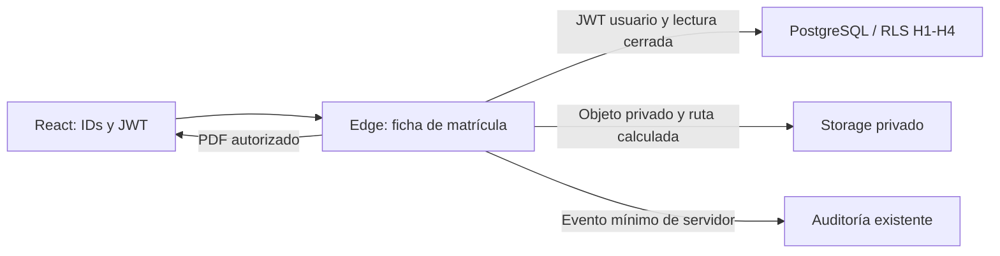

# H5 — Ficha de matrícula PDF: design

**DRAFT / hipótesis a evaluar. Gate 1 PENDIENTE; sin implementación H5.** Base, alcance y OQ bloqueantes: [requirements.md](requirements.md). Los identificadores DES corresponden uno a uno a REQ/TASK; [test-plan.md](test-plan.md) define evidencia futura, toda NO EJECUTADA.

## Referencias examinadas y modelo aceptado

- Fuente funcional/visual local: `D:/FRANKZ/aplicaciones/PERUMAR/DocumentosPM/Usuarios/ficha-perumar.pdf`, una página A4 vertical; imagen existente `ficha-perumar_page-0001.jpg`. SHA256 PDF: `B9B4FB2D6D8CA5F875D4040B3A5C42FA63AD2A4E80FC3D488C6AB2617655FD98`. Contiene datos personales de muestra: no se copian a Spec, fixtures, bundle ni Storage. No usarla como fondo con datos incrustados.
- Referencia legada revisada: `../perumar-React-WebFlux-DynamoDB-Cognito/perumar/src/main/resources/reports/ficha-matricula.jrxml` y su `MatriculaFichaPdfFieldPolicy.java`, fuera de este repositorio. Solo orientan etiquetas/maquetación; no se adopta Jasper, su DTO ni sus mínimos de validación.
- Fuentes de verdad actuales: migraciones H3 del modelo y comandos, `20261028200000_h3_occupation_catalog.sql` (snapshot vigente), `20261102020000_career_flags_student_code.sql`, auditoria de `20261022150000_h2_academic_model.sql`, seguridad H1–H4. Los datos reales se leerán de la matrícula, no de la muestra.
- Marca disponible: `src/assets/brand/perumar-isotipo.svg` y `perumar-logo.svg`; OQ-H5-002 aprueba el uso visual. Si hace falta un derivado estático compatible con PDF se prepara después de Gate 1, sin conversión remota/runtime genérica.

### DES-H5-001 — Frontera de evaluación

Hipótesis: React solicita una ficha; Edge verifica usuario, lee datos con RLS, genera, guarda en Storage privado y entrega bytes autorizados. PostgreSQL conserva autoridad de negocio; Edge no cobra, recalcula deuda ni altera matrícula. Un prototipo local exitoso no prueba calidad/seguridad hospedadas. Si aparecen una API genérica, colas, un servicio externo de render o capas no previstas, detener expansión y reportar a GATE-A01.

### DES-H5-002 — Plantilla y ausencias

La muestra contiene cabecera Curso/Promoción/Patrocinador, identificación, rasgos físicos/instrucción, nacimiento/domicilio, contactos, patrocinador y notas/espacios de firma/huellas. Su validez institucional actual no se presume. OQ-H5-002 debe aprobar texto y adaptación. Libro/Folio/Registro legal no tienen columnas H1–H4: omitir o dejar en blanco según esa decisión, nunca inventar ni usar el correlativo como registro oficial. Tampoco existe fotografía, firma o huella capturada. Ninguna tabla adicional para simular estos campos.

### DES-H5-003 — Contrato de procedencia propuesto (OQ-H5-001)

| Contenido | Fuente existente | Clase / regla |
| --- | --- | --- |
| Apellidos, nombres, DI, nacimiento, sexo, estado civil, teléfonos, domicilio y rasgos | `matricula.alumno_snapshot.alumno` | Históricos del snapshot; no sustituirlos silenciosamente por Alumno actual |
| Etiquetas de catálogos y geografía, incluida ocupación/OTROS | `alumno_snapshot.catalogos`, `.geografia` y texto `.alumno.ocupacion` | ID/etiqueta histórica; opcional ausente = Sin dato, no etiqueta actual inventada |
| Contactos | `alumno_snapshot.contactos` con su parentesco histórico | Todos los aplicables al momento de matrícula, incluso si hoy fueron retirados; no designar principal |
| Código Alumno | Snapshot si existe; `alumno.codigo_alumno` como identificador actual inmutable si falta en snapshots antiguos | Rotular procedencia; no inventar que ya existía en el snapshot |
| Código de matrícula, estado, fecha de inscripción | `matricula.codigo_matricula`, `.estado_codigo`, `.created_at` | Código/estado vigentes y fecha DB de inscripción; no regenerar código ni equivalerlo a Registro legal |
| Ciclo, Curso, promoción y ubicación contextual | `matricula.ciclo_id` → `ciclo` → `carrera` | Datos actuales al emitir; no hay snapshot de Curso/Ciclo histórico. Declarar esa diferencia tras traslados/ediciones |
| Patrocinador y datos de contacto | `matricula.empresa_patrocinadora_id` → `empresa_patrocinadora` | Actual, opcional y requerido por la referencia; teléfono no se convierte en celular por suponerlo. Sin facturación H7 |
| Edad | Fecha de nacimiento de fuente elegida y fecha explícita aprobada; propuesta: fecha del snapshot en Lima | Calculada en años calendarios, no almacenada; probar cumpleaños/bisiestos y frontera de día |
| Fecha de emisión / páginas | Reloj servidor, America/Lima / renderer | Calculadas, distintas de fecha de firma o matrícula; no completar una firma no realizada |
| Libro/Folio/Registro, fotografía, firma/huella digital | No existen | No aplicables como datos del modelo; decidir espacios impresos en OQ-H5-002 |
| Cargos/saldo/pagos / asignaturas | Existen `matricula_cargo`, H4 y `ciclo_materia`, pero no los exige la ficha fuente | No consultar ni imprimir por defecto; no añadirlos solo porque existen |

Esta mezcla propuesta se rotula, no se llama reproducción íntegramente histórica. Si se pide contexto histórico de Curso/Ciclo que no existe, registrar la brecha y resolver alcance; no crear historia retroactiva. Un dato esencial faltante produce error seguro; un opcional NULL se representa sin fabricación. Si se eligen datos actuales, actualizar y aprobar esta matriz antes de Gate 1, incluyendo fecha de edad/contactos.

### DES-H5-004 — Lectura y contrato de petición

Dos operaciones concretas de la misma ficha, no un motor documental: generar y descargar un artefacto. Peticiones POST con JWT en Authorization; IDs/versión en cuerpo, no PII ni tokens en URL. Generar admite únicamente matrícula UUID y expected_updated_at; descargar agrega UUID del artefacto. Rechazar campos extra (actor, permisos, bucket, path, HTML, PDF, importes, URLs). Actor y reloj son de servidor.

Propuesta de lectura: una consulta PostgREST con relaciones embebidas de Matrícula/Alumno/Ciclo/Curso/empresa bajo el JWT del usuario y RLS existente, proyectando campos cerrados. No usar service role para leer ficha ni resolver una denegación con una lectura privilegiada. La consulta debe ser coherente en una lectura DB; si el spike no puede lograrlo, justificar una única lectura concreta antes de ampliar inventario. expected_updated_at obsoleto devuelve 409 explícito, nunca RAISE 40001 lógico ni retry. Una relación inaccesible no se confunde con un FK NULL legítimo.

### DES-H5-005 — Renderer y fuente

Candidato técnico para el spike: renderer PDF directo compatible con Deno, por ejemplo [pdf-lib](https://pdf-lib.js.org/), sin seleccionarlo ni instalarlo ahora. Su documentación describe JS sin dependencias nativas y soporte Deno; no demuestra suficiencia Edge. Evaluar fuente licenciada, inclusión/subconjunto y todos los glifos españoles con parseo y render independientes. Evitar HTML-to-PDF como punto de partida; si se propone después, reabrir evaluación XSS/SSRF y presupuesto, sin introducir un navegador/servicio externo automáticamente.

### DES-H5-006 — Texto y unidades

Medir ancho real con la fuente elegida, envolver por palabras y caracteres cuando no haya espacios y calcular altura antes de dibujar. Mantener texto íntegro, acentos y nombres; no usar ellipsis para ocultar datos. Unidades explícitas del modelo: estatura_cm en cm, peso_kg en kg; no copiar la interpretación de unidades de la muestra. Respetar saltos de párrafo y tratar signos/HTML como texto. No reducir fuente para forzar una página.

### DES-H5-007 — Tablas

Tabla de contactos con columnas de nombre, parentesco, celular y dirección, todas desde la fuente aprobada. Altura variable, orden estable por ID del snapshot y encabezado repetido. Una fila mayor que el área de página necesita continuación claramente rotulada, no pérdida ni solapamiento. Probar 1 y 100 contactos sintéticos y direcciones de hasta 500 caracteres; son escenarios de carga documental, no nuevas reglas del Alumno.

### DES-H5-008 — Flujo de páginas

A4 vertical, márgenes propuestos de 12 mm, texto de datos al menos 9 pt y contraste de impresión legible. Reservar áreas de cabecera/pie; calcular saltos antes de cada bloque. Permitir páginas de continuación con rótulo de sección y página X de Y. No partir título de su primer contenido ni superponer footer. Si los datos exceden el presupuesto, rechazar con causa segura en vez de truncarlos. OQ-H5-002 aprueba adaptación institucional, no obliga a encajar todo en la página original.

### DES-H5-009 — Marca y elementos institucionales

Assets locales de versión conocida, tamaño acotado y licencia comprobada; sin logos/fuentes descargados desde URLs del usuario o del Curso. Fecha de emisión en Lima y encabezado PERÚ MAR. Resoluciones/declaraciones son texto institucional aprobado y versionado con la plantilla, no campos de negocio nuevos ni interpretación legal automática. Espacios impresos de firma/huellas no implican captura, prueba de consentimiento ni firma realizada.

### DES-H5-010 — UX y estado

Propuesta contextual: acción Ficha PDF de la matrícula, Generar explícito y Descargar autorizado. Mostrar ocupado y confirmar solo cuando haya archivo completo disponible; error conserva contexto. No agregar otro módulo de documentos H6, campos editables para la ficha ni edición de montos. OQ-H5-004 fija elegibilidad; denegar sin ocultar estado actual. Archivo generado antes de un cambio relevante no se entrega aparentando vigencia: revalidar fuente/estado y pedir regeneración explícita o copia histórica rotulada según decisión humana. Sin retry automático tras versión cambiada/timeout.

### DES-H5-011 — Objetos privados y propiedad

Bucket candidato `fichas-matricula`, privado. Path calculado en Edge: UUID de matrícula / UUID aleatorio de artefacto .pdf, nunca nombre/DI ni path enviado por React. El prefijo es vínculo lógico, no seguridad por ocultación. Metadata técnica: IDs, fecha servidor, versión de plantilla, modo de fuente, versión de matrícula y expiración si aplica; sin copiar ficha. Propietario lógico Matrícula; owner_id técnico del upload privilegiado no se trata como dueño humano.

Sin tablas de negocio nuevas por defecto. No emitir INSERT/SELECT/UPDATE/DELETE de este bucket a anon/authenticated ni políticas permisivas heredadas: probar denegación real de listado, carga, firma y lectura directas. Edge usa secreto únicamente para Storage y auditoría acotados a este flujo tras autorización de negocio; nunca llega a React ni se usa para eludir RLS de lectura. Verificar privilegios reales antes de añadir policies/RPC, no crear helpers genéricos.

### DES-H5-012 — Matriz de acceso

Director y Coordinador activos: generación/descarga si la matrícula es visible por RLS y elegible por OQ-H5-004. Admin sin rol académico, usuario sin rol, inactivo, JWT inválido o anónimo: denegados. Un académico autorizado puede consultar distintas matrículas conforme al alcance H1–H4; no se limita al creador ni se inventa relación auth.users→alumno. Validar perfil/roles actuales en DB, no confiar únicamente en claims antiguos ni en botones. Matrícula ajena/no accesible e ID inexistente deben tener respuesta segura equivalente sin enumeración útil.

### DES-H5-013 — Descarga autenticada y URLs

Propuesta primaria: Edge revalida JWT/rol/acceso/estado y sirve bytes desde Storage privado con application/pdf, Content-Disposition attachment (nombre genérico), Cache-Control private,no-store y CORS de orígenes explícitos. React recibe Blob en memoria y revoca su object URL local; no guarda PII/PDF/URL en storage web ni history.

No se emiten URLs firmadas en producto (TTL de emisión: no aplica); autenticación se valida por petición y token expirado se rechaza. La [documentación de Storage](https://supabase.com/docs/guides/storage/serving/downloads) distingue descargas autenticadas y URLs temporales, y advierte que una URL firmada individual no se revoca directamente. Se evita esa capacidad bearer como valor por defecto. TEST-H5-026 comprobará expiración real de una URL firmada creada solo por fixture privilegiada contra el bucket de ensayo; no añade una función de firma al producto. Si se cambia la decisión a URLs firmadas, se debe aprobar explícitamente TTL y exposición/revocación antes de incorporarlas; no asumir revocación inmediata al cambiar rol. Los bytes ya descargados no pueden recuperarse remotamente.

### DES-H5-014 — Dos generaciones y ciclo de vida

Cada petición explícita nueva usa UUID aleatorio distinto, sin overwrite y sin reciclar clave de pago H4. Versión de plantilla y procedencia describen cada artefacto; no hay gestor de versiones ni historial funcional. Doble clic se bloquea en UI; dos solicitudes reales pueden crear dos artefactos válidos, no dos matrículas/cobros. Ante respuesta perdida no afirmar éxito ni reenviar automáticamente; una regeneración explícita puede dejar el artefacto anterior privado hasta su retención.

OQ-H5-003 bloquea construcción del ciclo de vida. Propuesta: artefacto temporal 24 h, descarga expirada rechazada aunque aún esté físicamente, limpieza acotada vía Storage API en entorno/operación autorizados. No DELETE SQL de storage.objects, ni borrar historia de Alumno/Matrícula/pagos/auditoría. No cron, cola o servicio nuevo por defecto; si limpieza manual no es operable, medir el costo y reportar la brecha para decisión antes de añadir infraestructura. Retención permanente puede invadir H6 y no se presume.

### DES-H5-015 — Errores y presupuesto inicial a medir

Códigos HTTP seguros: 401 token inválido/expirado; 403 rol denegado; 404 matrícula/artefacto no accesible o inexistente; 409 versión/estado cambiado; 413 límite; 422 datos esenciales insuficientes; 503 fallo controlado de dependencia. Un 504/terminación de Runtime puede impedir responder: el cliente no lo transforma en éxito ni reintenta. Mensajes con categoría y correlation ID, sin payload, SQL, nombres, paths privados, URL o stack.

Presupuesto propuesto para evaluar, no un benchmark ejecutado: cuerpo ≤4 KiB, PDF ≤2 MiB, hasta 20 páginas y fixture de 100 contactos; p95 de generación completa ≤15 s en el entorno medido, CPU objetivo ≤1.5 s y memoria objetivo ≤128 MiB. Registrar frío/caliente y mínimo 20 muestras por escenario. No confundir tiempo de pared con CPU. Si no hay métrica, marcarla NO MEDIDA y no declarar cumplimiento. Estos límites no cambian las longitudes o multiplicidad de negocio; exceso se reporta y se evalúa como limitación, no se pierde texto.

### DES-H5-016 — Auditoría mínima y compensación

Auditoria existente no tiene un evento PDF: no falsear una modificación de Matrícula para disparar su trigger. Candidato justificado exclusivamente por REQ-H5-016: un comando concreto `registrar_evento_ficha_pdf`, no tabla nueva ni motor, ejecutable solo por el canal servidor privilegiado. Valida actor verificado y activo en DB, matrícula y evento de lista cerrada; metadatos whitelist (artefacto/plantilla/fase/tamaño), sin JSON arbitrario o PII completa. Authenticated/anon no pueden falsificar eventos ni actor por Data API.

Eventos mínimos: FICHA_PDF_GENERADA tras upload completo y FICHA_PDF_DESCARGA_INICIADA antes de responder bytes. No afirmar descarga consumida/archivo guardado por el usuario. Si falla auditoría de generación después de upload, no entregar el archivo y compensar con borrado del objeto derivado; si también falla compensación queda huérfano privado sujeto a limpieza, no éxito falso. Auditoría/Storage no son una transacción distribuida. Denegaciones/errores usan logs mínimos con correlation ID/fase/categoría, sin datos personales, JWT, secretos, PDF ni URLs. Auditar una eliminación solo si la política aprobada lo requiere, sin crear CRUD documental general.

### DES-H5-017 — Amenazas y Secure SDLC

Revisión antes de elegir renderer/dependencias y antes de entregar: IDOR/matrícula ajena, actor/rol falsificado, SQL/texto malicioso, HTML/script, PDF con acciones activas, traversal/encoding, SSRF por logo/fuente/URL, CORS/CSRF, secretos y logs, abuso de tamaño/tiempo. PDF se construye con texto; no ejecutar HTML, JS, plantillas o URLs de entrada. Sin recursos externos desde contenido no confiable; Supabase destino configurado por servidor. Rechazar campos extra e IDs inválidos antes de lecturas privilegiadas. Revisar licencia/versiones/integridad de dependencias, ninguna flotante. Referencias: [OWASP Authorization](https://cheatsheetseries.owasp.org/cheatsheets/Authorization_Cheat_Sheet.html) y [OWASP SSRF](https://raw.githubusercontent.com/OWASP/CheatSheetSeries/master/cheatsheets/Server_Side_Request_Forgery_Prevention_Cheat_Sheet.md). No se declara conformidad/certificación OWASP por escribir este Spec.

### DES-H5-018 — Spike real después de Gate 1

Primero PDF mínimo reproducible en Edge Runtime con usuario/fixture sintéticos y OQ resueltas; después textos/tablas/páginas y Storage. Fijar versiones, fuentes y comando de ejecución; medir recursos y evidencia visual. No instalar dependencias ni crear funciones en esta fase Spec. La compatibilidad declarada por una biblioteca no sustituye esta prueba.

[Auth de Edge](https://supabase.com/docs/guides/functions/auth): la llamada de usuario debe verificar el JWT y conservar un cliente sujeto a RLS; una clave pública no representa autenticación de usuario. No desactivar controles para superar un 401. [Límites hospedados](https://supabase.com/docs/guides/functions/limits), consultados 12/11/2026: memoria 256 MB, CPU 2 s por petición y duración de worker distinta según plan; reconfirmar al ejecutar, no trasladar la holgura local al hospedado. Comprobar canal/tamaño de despliegue y assets. Prueba hospedada solo en proyecto/credenciales de ensayo autorizados, nunca producción ni link remoto de la base humana. Sin ella, o sin medidas suficientes, registrar aptitud hospedada inconclusa y llevarla a GATE-A01; no fabricar PASSED.

### DES-H5-019 — Fallos, concurrencia y no regresión

Orden propuesto: autorización/lectura → validación → render completo → upload privado → auditoría → entrega. Inyectar fallo en cada frontera. Nunca exponer bytes incompletos como PDF válido; uploads huérfanos quedan privados y trazados por metadata técnica para limpieza autorizada. Probar dos generaciones/descargas y revocación antes de entregar; no prometer retirar una copia ya recibida. Obtener fingerprints/contadores de datos H1–H4 para demostrar que solo cambian artefactos derivados y eventos mínimos. Fixtures y limpieza en entorno desechable; no reset sobre datos humanos.

### DES-H5-020 — Dictamen y límites de inventario

Inventario candidato mínimo a comprobar, no objetos creados/aprobados: una Edge Function específica con generar/descargar; un bucket privado; cero tablas de negocio/vistas nuevas; como máximo un comando de auditoría de propósito concreto si la evidencia justifica su necesidad. Sin políticas de acceso directo del cliente a este bucket por defecto. Cualquier diferencia debe justificarse por requisito y revisarse; no introducir capas o servicios para forzar un sí.

Informe final futuro: biblioteca/fuente/versiones, capturas de páginas, matriz de seguridad, mediciones por escenario, errores/compensación, pasos reproducibles, esfuerzo y mantenimiento estimados con trabajo real. Costo por 1,000 generaciones/descargas con tamaños, retención, invocaciones/egreso y tarifa vigente citada al medir; no inventar importes medidos. [AWS Well-Architected](https://docs.aws.amazon.com/wellarchitected/latest/framework/the-pillars-of-the-framework.html) se usa como marco de Seguridad, Fiabilidad, Rendimiento, Costos y Excelencia operacional, no como obligación de usar AWS.

Conclusión suficiente solo si calidad, seguridad, presupuesto y mantenibilidad tienen evidencia; no suficiente si fallan requisitos sin solución razonable en la frontera; inconcluso si faltan pruebas esenciales. GATE-A01 es humano en todos los casos. Resultado negativo/inconcluso no instala Lambda, WebFlux, Node permanente, navegador remoto, colas ni infraestructura. Entregar candidato H5 para Gate 2/evaluación humana; no aprobar gates ni continuidad automáticamente.
